<div align="center">


# UniTask

**A local-first Android task manager for university students.**

Deadlines, timetable, reminders, personal tasks and study groups in a single application.
No advertising. No tracking.

[](https://github.com/ahmad-maqsood/unitask/releases/latest)
[](https://github.com/ahmad-maqsood/unitask/releases)
[](https://www.android.com/)
[](https://kotlinlang.org/)
[](https://supabase.com/)
[](LICENSE)
[](docs/SECURITY_SCANNING.md)
[](https://scorecard.dev/viewer/?uri=github.com/ahmad-maqsood/unitask)
[](https://hub.xerj.org/contributors/ahmad-maqsood)

[**Download the latest APK**](https://github.com/ahmad-maqsood/unitask/releases/latest)

[Overview](#overview) · [Screenshots](#screenshots) · [Installation](#installation) · [Building from source](#building-from-source) · [Features](#features) · [Architecture](#architecture) · [Privacy](#privacy-and-permissions) · [Security scanning](#security-scanning) · [Repository security](#repository-security) · [Limitations](#known-limitations) · [Support](#support)

</div>

---

## Overview

UniTask helps students keep track of what is due, when classes start and what their study group still has to finish. It is designed around three principles.

| Principle | Description |
| --- | --- |
| **Offline first** | Deadlines, personal tasks, courses, the timetable and reminders are stored on the device. No account is required to use them. |
| **Optional cloud** | Signing in with Google is for study groups. |
| **Private by design** | The application contains no advertising and no tracking. |

### Highlights

- **Coursework.** Deadlines with priorities, reminders and attachments, colour-coded courses and repeating tasks.
- **Timetable.** Weekly or bi-weekly schedule with a live next-class card and `.ics` export.
- **Notes.** Markdown notes with a preview mode, find in note, code highlighting, course tags and photos. Deleted notes stay in the trash for 30 days.
- **Study timer.** Stopwatch, countdown and Pomodoro (focus and break rounds) that alert you when time is up, even if the app is closed.
- **Progress.** Tasks finished this week, your streak and how far each course is.
- **Study groups.** Shared tasks, joined with a QR code, an invite link or a code.
- **Backup.** Optional private backup to your own Google Drive, and password-protected local backups.

UniTask is a personal project, created to solve everyday planning problems for its author and classmates.

## Screenshots

Jump to: [Plan your work](#plan-your-work) · [Study tools](#study-tools) · [Notes](#notes) · [Groups, search and trash](#groups-search-and-trash) · [Settings](#settings) · [Themes](#themes)

### Plan your work

Deadlines, classes and courses, plus personal tasks that need no account.

<table align="center">
  <tr>
    <td align="center" valign="top"><a href="docs/screenshots/deadlines.jpg">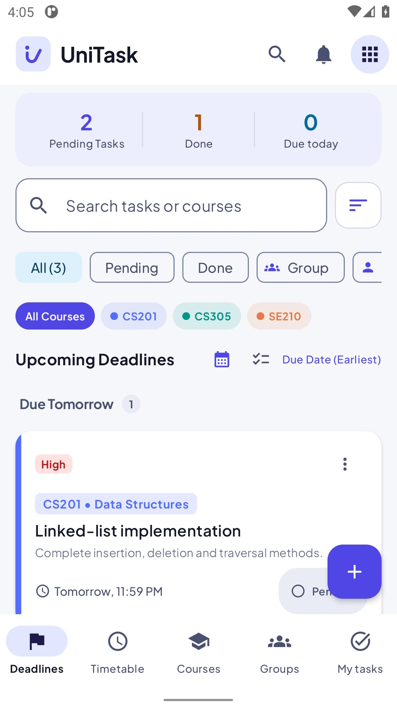</a><br/><sub><b>Deadlines</b><br/>Upcoming work and daily overview</sub></td>
    <td align="center" valign="top"><a href="docs/screenshots/add_task.jpg">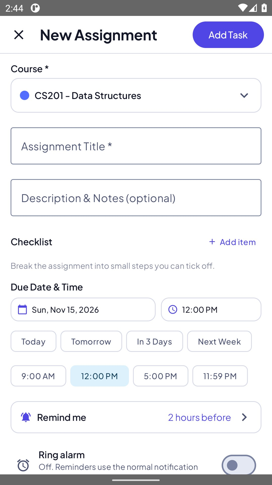</a><br/><sub><b>New assignment</b><br/>Add a deadline with priority, reminders and files</sub></td>
    <td align="center" valign="top"><a href="docs/screenshots/my_tasks.jpg">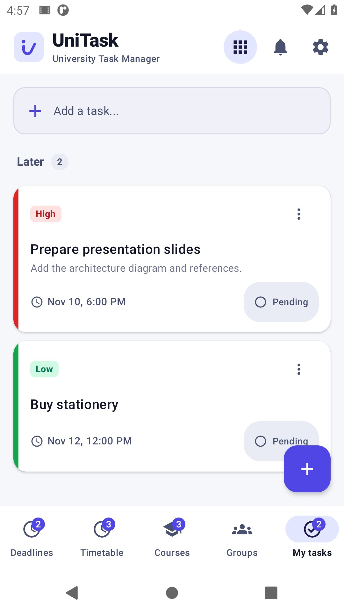</a><br/><sub><b>My tasks</b><br/>Personal to-do list</sub></td>
  </tr>
  <tr>
    <td align="center" valign="top"><a href="docs/screenshots/timetable.jpg">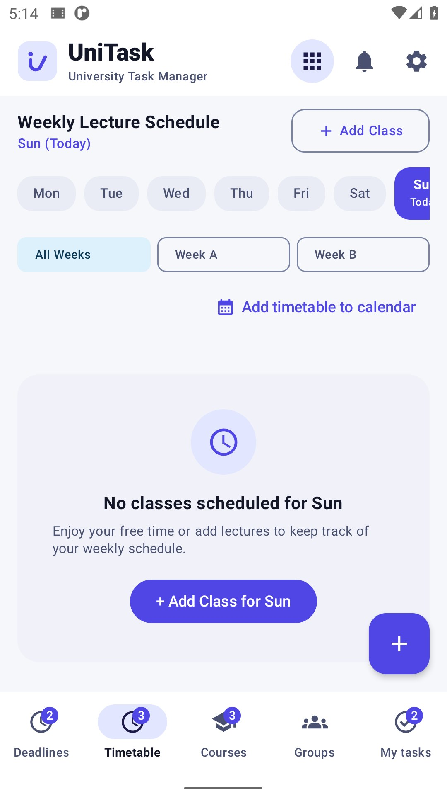</a><br/><sub><b>Timetable</b><br/>Weekly class schedule</sub></td>
    <td align="center" valign="top"><a href="docs/screenshots/courses.jpg">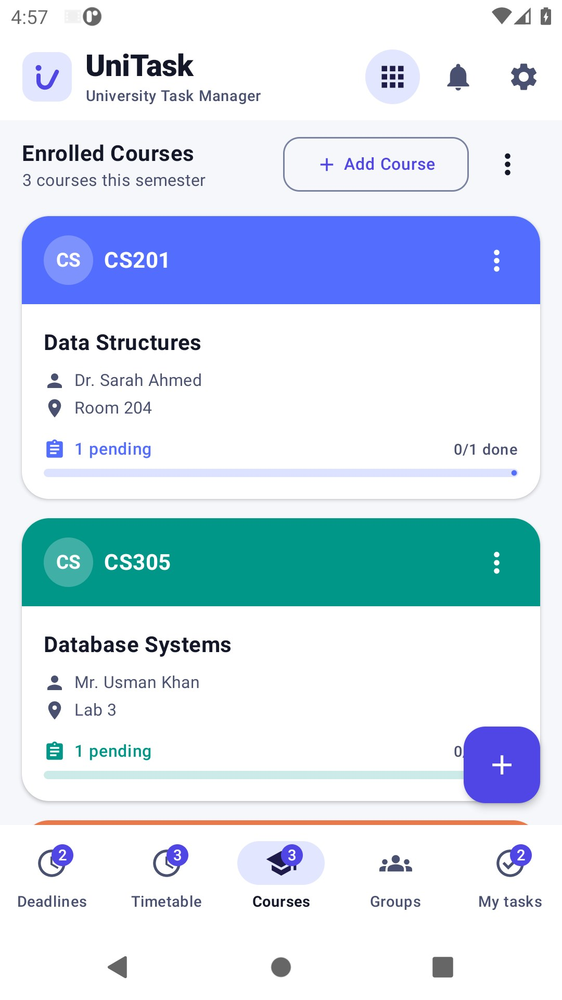</a><br/><sub><b>Courses</b><br/>Course list and colour coding</sub></td>
    <td align="center" valign="top"><a href="docs/screenshots/course_detail.jpg">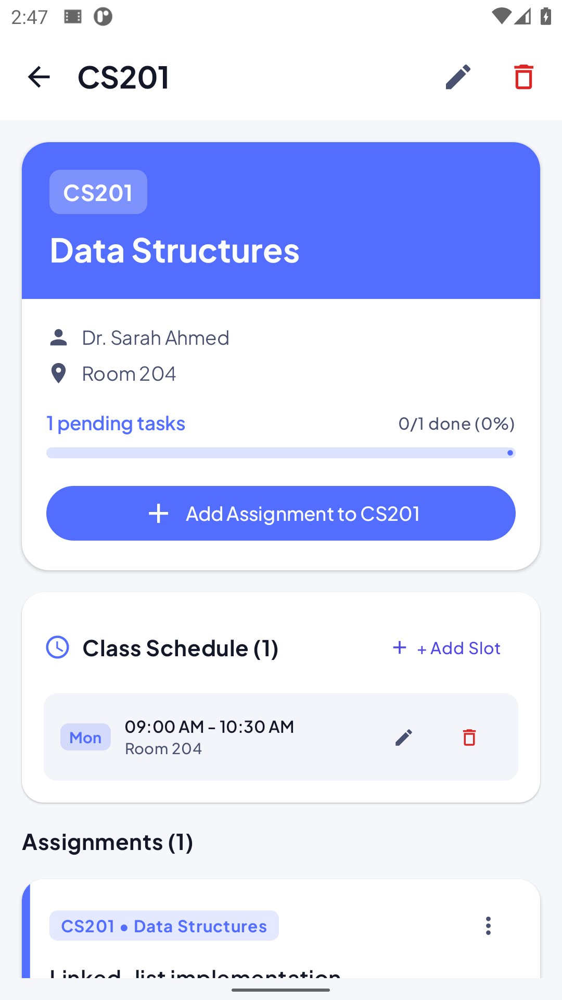</a><br/><sub><b>Course details</b><br/>Every task and class for one course</sub></td>
  </tr>
</table>

### Study tools

Everything in the More menu, from the timer to your weekly progress.

<table align="center">
  <tr>
    <td align="center" valign="top"><a href="docs/screenshots/tools_menu.jpg">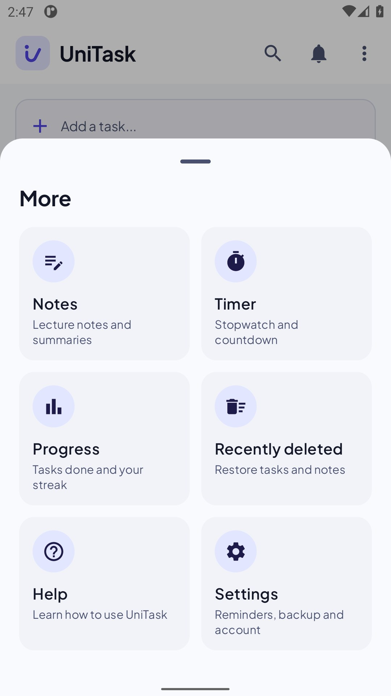</a><br/><sub><b>More menu</b><br/>Notes, timer, progress, search and more</sub></td>
    <td align="center" valign="top"><a href="docs/screenshots/timer.jpg">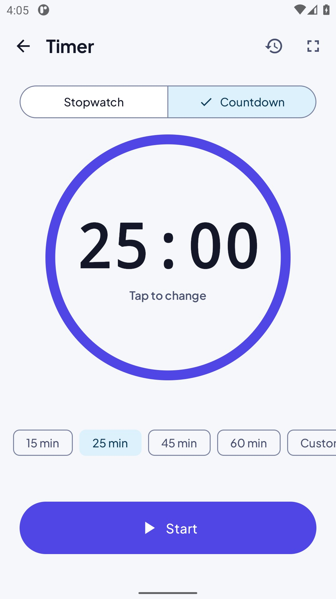</a><br/><sub><b>Study timer</b><br/>Stopwatch and countdown for study sessions</sub></td>
    <td align="center" valign="top"><a href="docs/screenshots/timer_pomodoro.jpg">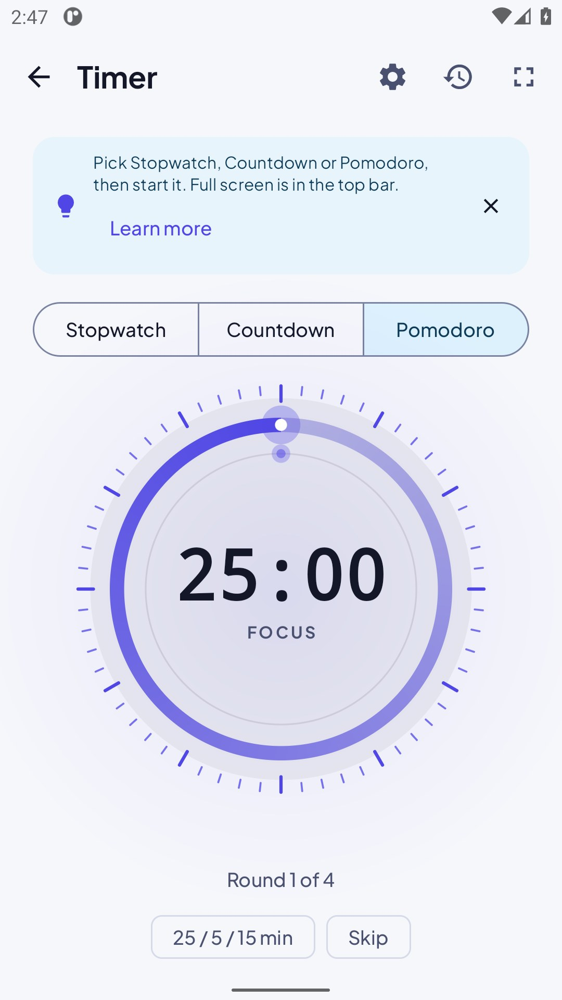</a><br/><sub><b>Pomodoro</b><br/>Focus and break rounds</sub></td>
  </tr>
</table>

<table align="center">
  <tr>
    <td align="center" valign="top"><a href="docs/screenshots/timer_options.jpg">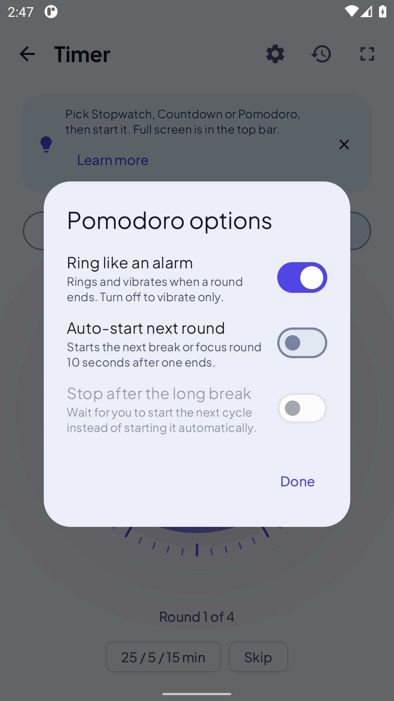</a><br/><sub><b>Pomodoro options</b><br/>Alarm or vibrate, and auto-start the next round</sub></td>
    <td align="center" valign="top"><a href="docs/screenshots/progress.jpg">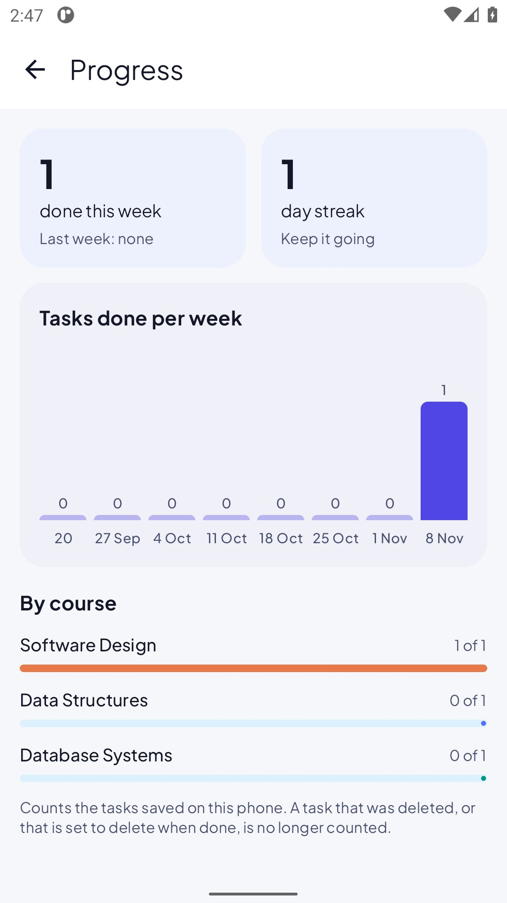</a><br/><sub><b>Progress</b><br/>Tasks finished this week and your streak</sub></td>
  </tr>
</table>

### Notes

Markdown notes with a live preview, linked to your courses.

<table align="center">
  <tr>
    <td align="center" valign="top"><a href="docs/screenshots/notes.jpg">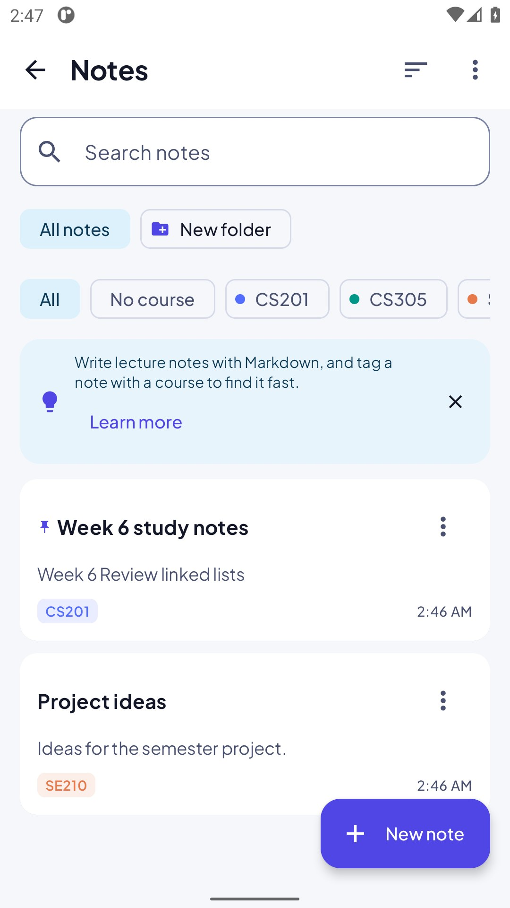</a><br/><sub><b>Notes</b><br/>Pinned and course-linked notes</sub></td>
    <td align="center" valign="top"><a href="docs/screenshots/note_preview.jpg">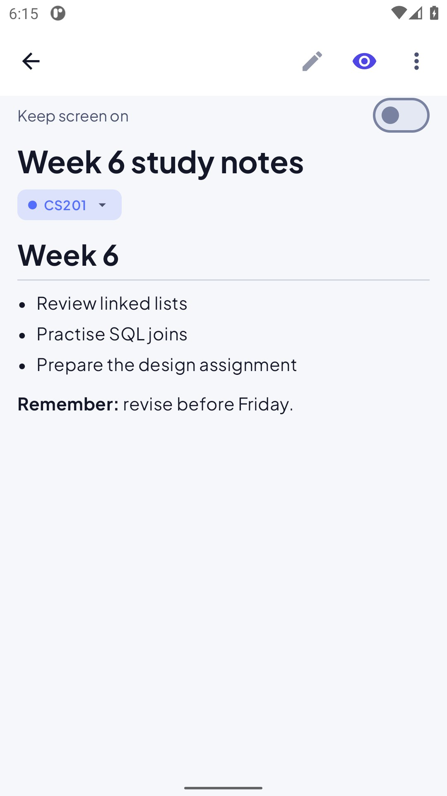</a><br/><sub><b>Note preview</b><br/>Formatted Markdown preview</sub></td>
    <td align="center" valign="top"><a href="docs/screenshots/note_editor.jpg">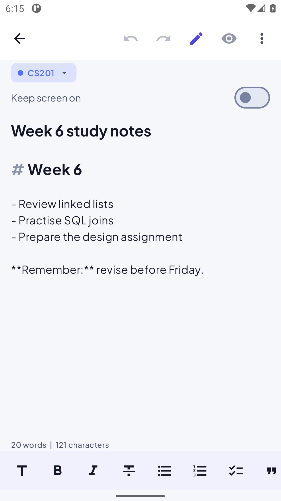</a><br/><sub><b>Note editor</b><br/>Markdown editing and formatting tools</sub></td>
  </tr>
</table>

### Groups, search and trash

Share work with classmates, find anything fast and undo a deletion.

<table align="center">
  <tr>
    <td align="center" valign="top"><a href="docs/screenshots/groups.jpg">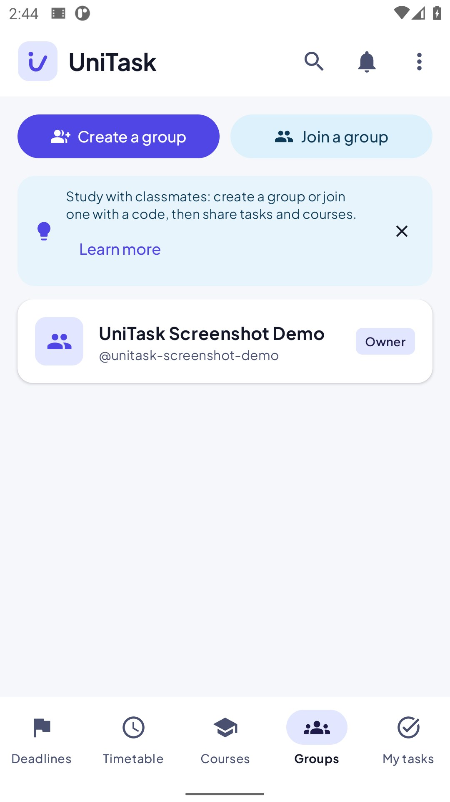</a><br/><sub><b>Study groups</b><br/>Shared study spaces</sub></td>
    <td align="center" valign="top"><a href="docs/screenshots/global_search.jpg">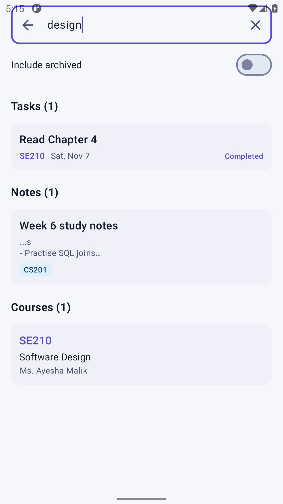</a><br/><sub><b>Global search</b><br/>Find tasks, notes and courses in one place</sub></td>
    <td align="center" valign="top"><a href="docs/screenshots/recently_deleted.jpg">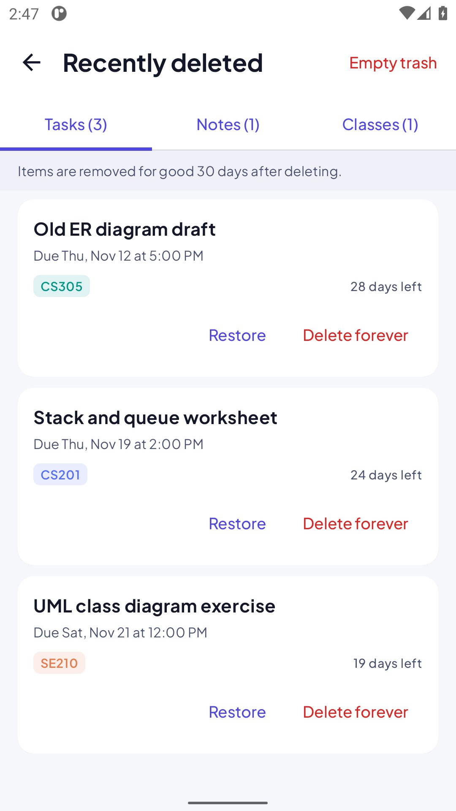</a><br/><sub><b>Recently deleted</b><br/>Restore deleted tasks, notes and classes for 30 days</sub></td>
  </tr>
</table>

### Settings

Reminders, backup and account options, one section at a time.

<details>
<summary>Show the 5 settings screens</summary>

<table align="center">
  <tr>
    <td align="center" valign="top"><a href="docs/screenshots/settings_menu.jpg">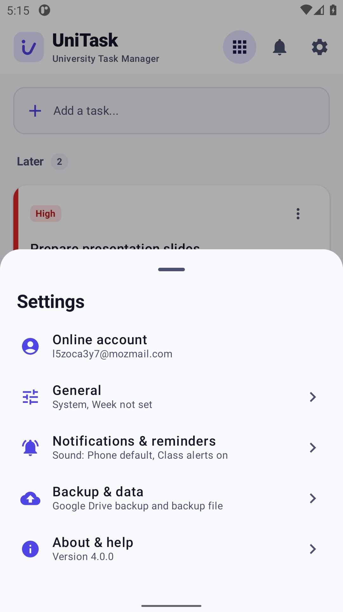</a><br/><sub><b>Settings</b><br/>Settings overview</sub></td>
    <td align="center" valign="top"><a href="docs/screenshots/settings_general.jpg">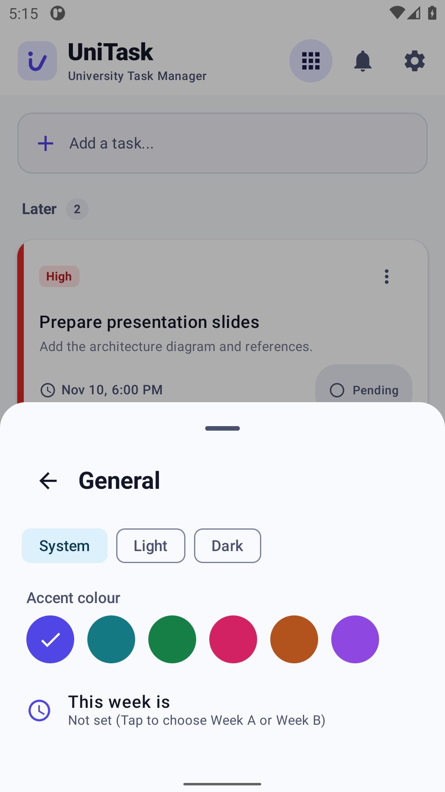</a><br/><sub><b>General settings</b><br/>Theme and app preferences</sub></td>
    <td align="center" valign="top"><a href="docs/screenshots/settings_notifications.jpg">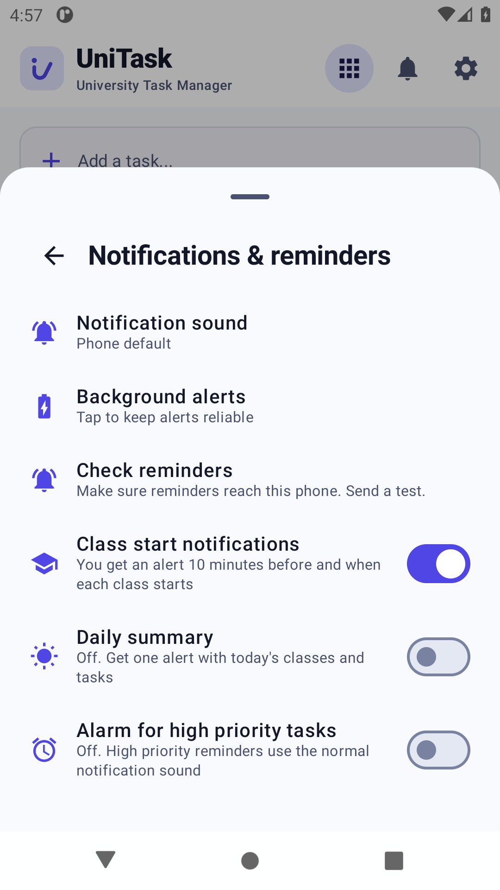</a><br/><sub><b>Notifications</b><br/>Reminder controls</sub></td>
  </tr>
</table>

<table align="center">
  <tr>
    <td align="center" valign="top"><a href="docs/screenshots/settings_backup.jpg">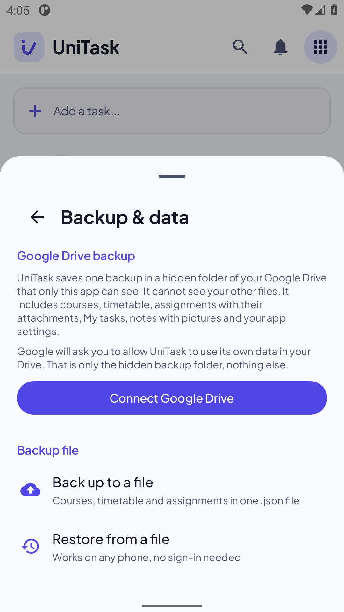</a><br/><sub><b>Backup and data</b><br/>Backup and data options</sub></td>
    <td align="center" valign="top"><a href="docs/screenshots/settings_about.jpg">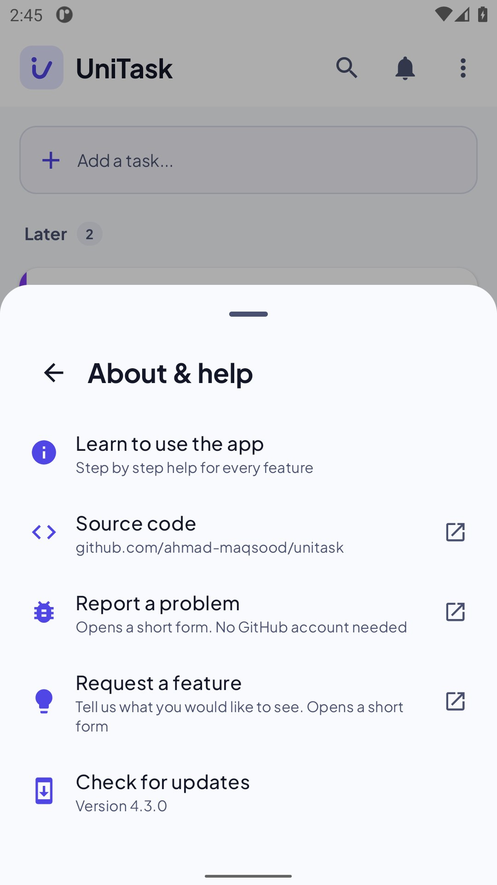</a><br/><sub><b>About and help</b><br/>App information and support</sub></td>
  </tr>
</table>

</details>

### Themes

UniTask follows the system theme or can be set to light or dark, with ten accent colours chosen in Settings.

<table align="center">
  <tr>
    <td align="center" valign="top"><a href="docs/screenshots/theme_dark.jpg">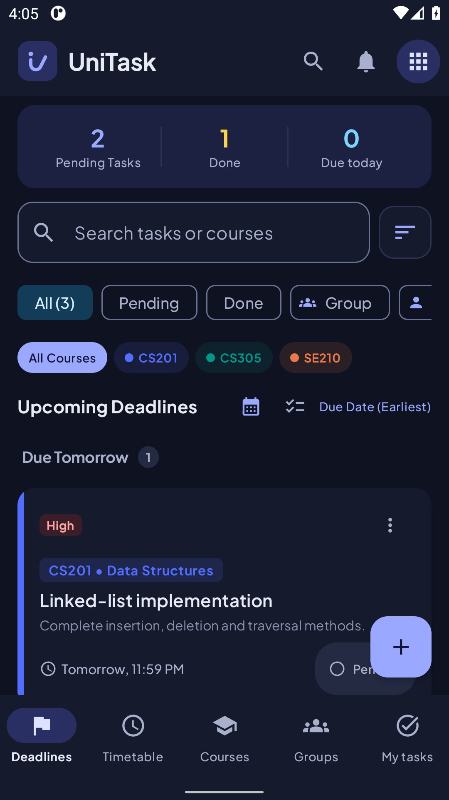</a><br/><sub><b>Dark theme</b><br/>Deadlines in dark mode</sub></td>
    <td align="center" valign="top"><a href="docs/screenshots/theme_accent.jpg">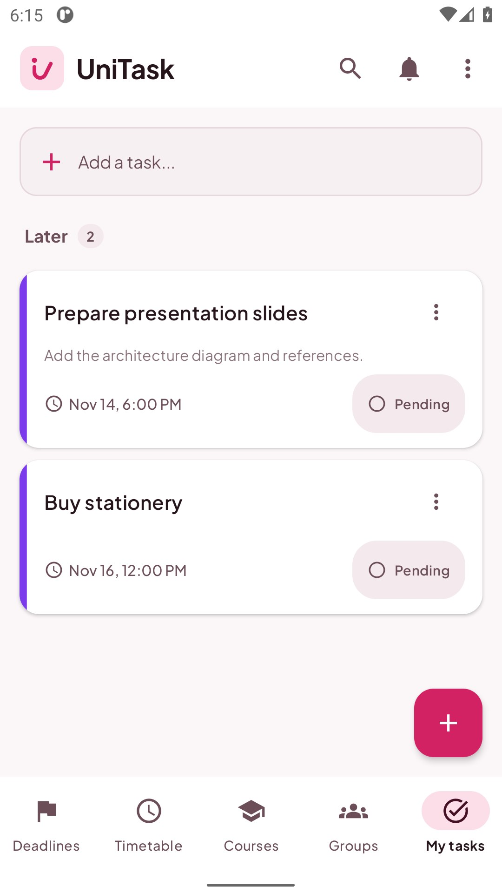</a><br/><sub><b>Accent colours</b><br/>Ten accent colours, shown here in Rose</sub></td>
  </tr>
</table>

<p align="center"><sub>Automatically captured from UniTask 4.3.0 using fictional demo data on an Android emulator.</sub></p>

Each screen is also available separately: [**Deadlines**](docs/screenshots/deadlines.jpg) · [**New assignment**](docs/screenshots/add_task.jpg) · [**My tasks**](docs/screenshots/my_tasks.jpg) · [**Timetable**](docs/screenshots/timetable.jpg) · [**Courses**](docs/screenshots/courses.jpg) · [**Course details**](docs/screenshots/course_detail.jpg) · [**More menu**](docs/screenshots/tools_menu.jpg) · [**Study timer**](docs/screenshots/timer.jpg) · [**Pomodoro**](docs/screenshots/timer_pomodoro.jpg) · [**Pomodoro options**](docs/screenshots/timer_options.jpg) · [**Progress**](docs/screenshots/progress.jpg) · [**Notes**](docs/screenshots/notes.jpg) · [**Note preview**](docs/screenshots/note_preview.jpg) · [**Note editor**](docs/screenshots/note_editor.jpg) · [**Study groups**](docs/screenshots/groups.jpg) · [**Global search**](docs/screenshots/global_search.jpg) · [**Recently deleted**](docs/screenshots/recently_deleted.jpg) · [**Settings**](docs/screenshots/settings_menu.jpg) · [**General settings**](docs/screenshots/settings_general.jpg) · [**Notifications**](docs/screenshots/settings_notifications.jpg) · [**Backup and data**](docs/screenshots/settings_backup.jpg) · [**About and help**](docs/screenshots/settings_about.jpg) · [**Dark theme**](docs/screenshots/theme_dark.jpg) · [**Accent colours**](docs/screenshots/theme_accent.jpg).

## Installation

1. Open the [latest release](https://github.com/ahmad-maqsood/unitask/releases/latest).
2. Download the `.apk` file and open it on your phone. If Android asks, allow installation from your browser or file manager.
3. To update an existing installation, use the update button in the top bar or open **Settings, Check for updates**. The check compares your installed version with the tag of the newest GitHub release.

UniTask requires **Android 7.0 (API 24)** or newer.

> [!NOTE]
> Beta builds are published as **pre-releases** on the [Releases page](https://github.com/ahmad-maqsood/unitask/releases). They are not offered by **Check for updates** and must be installed manually.

## Building from source

**Requirements**

- A recent stable release of Android Studio.
- JDK 21, the version used by the project's continuous integration.
- An Android 7.0 (API 24) or newer device or emulator to run the app.

**Build and test**

```bash
git clone https://github.com/ahmad-maqsood/unitask.git
cd unitask
./gradlew assembleDebug        # builds a debug APK in app/build/outputs/apk/debug/
./gradlew testDebugUnitTest    # runs the unit tests
```

You can also open the cloned folder in Android Studio and let Gradle sync before running the app. Cloud features that use Supabase or Google Sign-In require your own service configuration and credentials. Never commit secrets to the repository.

**Supabase settings.** The Supabase URL and anon key are not stored in the code. The build reads them from a `.env` file in the project root, which Git ignores. To connect the groups feature to your own Supabase project, copy `.env.example` to `.env` and replace the two placeholder lines:

```
SUPABASE_URL=https://your-project.supabase.co
SUPABASE_ANON_KEY=your-supabase-anon-key
```

Without a `.env` file the app still builds, using the placeholders, but groups will not connect. In GitHub Actions the `.env` file is created from the repository secrets `SUPABASE_URL` and `SUPABASE_ANON_KEY`, and the release build stops if either is missing.

## Features

### Coursework

- **Deadlines.** Assignments with priority, due date and exact time, linked to colour-coded courses.
  - A statistics card shows Pending, Done and Due today.
  - Tasks are grouped by urgency: Overdue, Due Today, Due Tomorrow, Upcoming and Completed.
  - Swipe a card to the right to mark it done, with Undo.
  - A calendar view shows a month grid with deadline indicators.
  - A checklist editor supports subtasks, with live progress on the card.
  - Batch selection completes or deletes several tasks at once.
  - Each task can have multiple reminders and offline file attachments of up to 25 MB.
- **Courses.** Modules, credit hours, instructors and colour tags, which timetable slots and assignments inherit.
- **Repeating tasks.** Tasks can repeat daily, on weekdays, weekly, every two weeks, monthly or yearly. A completed repeating task moves to its next due date and its checklist is reset.
- **Get started card.** A checklist on the Deadlines tab for new users: allow notifications, turn off battery optimization, enable auto-start, then add a course, a deadline, a reminder and a class, try the timer and back up. The three phone-setting steps are read live from the phone, so they un-tick if you turn the setting off again.
- **My tasks.** A separate to-do list for items that are not coursework, with quick add, swipe to complete or delete with undo, and sections for overdue, today, tomorrow, later and done. One-time tasks can use **Delete when done**, which removes them the day after they are finished.

### Progress

- Open **Progress** from the More menu to see tasks finished this week compared with last week, your streak (days in a row with at least one task finished), the last weeks as bars, and how many tasks are done in each course.

### Notes

- **Markdown notes.** Notes with an optional course tag, opened from the More menu in the top bar.
  - Formatting toolbar with shortcuts for headings, bold, italic, strikethrough, checklists, bulleted and numbered lists, quotes, inline code, code blocks, links, tables and images.
  - Edit and Preview modes with interactive checklists that can be ticked in Preview.
  - **Find in note** searches the text of the open note, in both Edit and Preview.
  - Fenced code blocks (for example ` ```kotlin `) get syntax highlighting.
  - Pinch with two fingers to change the text size. The size is remembered between notes.
  - Fast search by title and content, filter by course, pin important notes and sort by updated date, created date or title.
  - Autosave as you type with full undo and redo history in the editor.
  - Recently deleted notes are kept in the trash for 30 days before permanent deletion, with instant restore.
  - Share notes as plain text or export as `.md` or PDF files, and import `.md` or `.txt` files directly into Notes.
  - Open Markdown files from other apps via "Open with" and Share, and save the preview to Notes.
  - Photos from the gallery are stored locally with thumbnail preview, full-screen viewing and automatic orphan cleanup.
  - Notes are included in encrypted local backups, data export and Google Drive backup.
  - Deleting a course keeps notes safe and cleanly detaches the course link.

### Study timer

- **Stopwatch, countdown and Pomodoro.** Track study sessions with a stopwatch, a 15, 25, 45 or 60-minute countdown (or a custom duration), or Pomodoro mode with focus rounds and short and long breaks you can adjust. Pause and resume whenever needed, use a fullscreen landscape display, and keep the screen awake. A notification alerts you when a countdown ends, even if UniTask is closed. The timer can keep running when you leave its screen, with an active indicator on the More button.

### Timetable

- Weekly and bi-weekly (**Week A** and **Week B**) schedules. Once you set the current week, reminders, the daily summary and the next-class card follow it.
- A live current and next class card, free-time indicators between classes and clash warnings.
- One-tap `.ics` export for Google Calendar, Outlook and Apple Calendar.

### Study groups

- Create or join a group with a **QR code** (scanned with the camera or from an image), an invite link or an 8-character code.
- Owner tools to rename the group, regenerate codes and transfer ownership.
- Shared tasks with member tagging (`@all`), shared courses and personal done ticks.

### Reminders and widget

- Notifications include **Mark as Done** and **Snooze 30m** actions.
- Snooze from the task card for 30 minutes, 1 hour, 3 hours or tomorrow morning. The card shows "Snoozed until ...".
- On Android 13 and newer, reminders ring at the exact time. Reminders are skipped for tasks that were already finished or deleted.
- A **Missed reminder** notification reports reminders that were due while the phone was off.
- **Check reminders** in Settings tests notifications, exact alarms and battery settings, can fix detected problems and can send a test reminder.
- Optional alarm-style ringing for high-priority tasks, class reminders and a daily morning summary.
- Notifications are grouped by type to keep the notification shade readable.
- **Notification history.** Review past alerts, see unread counts and jump back to the relevant item; daily summaries remain available in the history.
- The **UniTask Today** home-screen widget shows today's classes and tasks. Tapping a row opens the app.

### Personalisation

- Light, dark or system theme, and ten accent colours: Indigo, Ocean teal, Forest green, Rose, Sunset orange, Violet, Cobalt blue, Golden amber, Graphite and Mocha.
- Themed icon on Android 13 and newer.
- Notification sounds: the phone default, four built-in sounds or any ringtone on the phone. Each sound has its own notification channel, so Android remembers the volume you set.

### Google Drive backup

- **Private cloud backup.** Saves one hidden backup in the user's own Google Drive that only UniTask can see. It cannot see your other files.
  - Includes courses, timetable, assignments with attachments, My tasks, notes with pictures and app settings.
  - Back up on a tap or daily after the app opens (runs at most once a day and only when something has changed).
  - Restore on a new phone with settings applied at once.
  - Google Drive keeps a latest and an older backup (about a day behind), and the restore window lets you pick the older one.
  - Two rotating copies ensure a failed upload cannot destroy the last good one.
  - Wi-Fi only and attachments switches to control mobile data and storage.

### Backup and data

- Password-protected offline backups (courses, timetable, assignments, notes with pictures and app settings) and a JSON export of your data.
- Deleting the online account.
- A GitHub release updater, an announcements bell and a built-in **Learn to use the app** guide.

## Architecture

UniTask is local-first. Personal data lives in Room on the device and is backed up to the user's own Google Drive, so the application remains fast and usable offline. Supabase is used for groups and announcements.

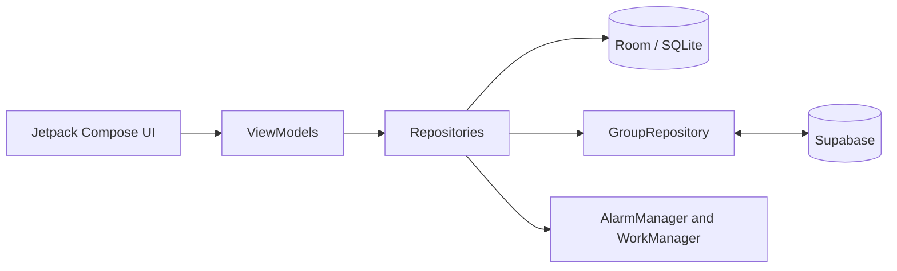

### Technology stack

| Layer | Technology |
| --- | --- |
| UI | Kotlin, Jetpack Compose, Material 3 |
| Home-screen widget | Jetpack Glance |
| Local data | Room 2.8.5 with explicit migrations |
| Cloud | Supabase (`supabase-kt` 3.8.0): Auth with Google sign-in, PostgREST and Realtime |
| Networking | Ktor 3.6.1 |
| Background work | `AlarmManager` for exact reminders, `WorkManager` for periodic sync and announcement polling |
| Build | Android Gradle Plugin 9.5.0, Gradle 9.8.2 (Kotlin DSL), version catalog, KSP, minimum SDK 24, target SDK 36 |
| Continuous integration | GitHub Actions builds the signed release APK, runs tests and lint, and scans the code with CodeQL |

### Synchronisation

- Personal data is stored on the device in Room and can be backed up to the user's own Google Drive. It is not uploaded to Supabase.
- Group screens use Supabase Realtime for instant updates, with a short polling safety net in case an event is missed.
- Actions in groups, such as adding a task or ticking it done, appear on screen immediately and are confirmed by the server shortly afterwards.
- Row Level Security on every table controls who can read and write which data. The anon key in the application is public by design and carries no additional access.
- Database triggers set the author name of group tasks on the server. A member therefore cannot post under another member's name.

<details>
<summary><b>Project layout</b></summary>

```text
app/src/main/java/com/example/
  data/
    local/         Room entities, DAOs, migrations, repeat rules
    groups/        Group repository and models (Supabase realtime)
    repository/    AppRepository for personal data, NoteRepository
  sync/            PeriodicSyncWorker, DriveBackupWorker, SyncScheduler
  reminder/        Task, class, daily-summary, group and announcement alarms, snooze and receivers
  widget/          "UniTask Today" home-screen widget (Glance)
  ui/
    screens/       Compose screens, dialogs and ViewModels
    theme/         Colours, accent themes, typography, theme preference
  util/            Supabase client, local backup, update checker, announcements,
                   attachments, notification sounds, .ics export, QR codes,
                   progress statistics, Get started steps, RunLogged
    crash/         Local crash log and crash reporter
    drive/         Google Drive backup
    markdown/      Markdown helpers and code highlighter
    timer/         Stopwatch, countdown and Pomodoro timer
app/schemas/       Room database schema files, one per version, read by the migration test
supabase/          schema.sql, a reference copy of the live database
.github/workflows/ Release APK build, tests, CodeQL and a Supabase keep-alive ping
```

</details>

## Reliable notifications

Some phone manufacturers aggressively stop background applications. If reminders arrive late or not at all:

1. Allow **Autostart** for UniTask, if your phone offers the option.
2. Set battery usage to **No restrictions**.
3. Allow background activity and exact alarms if Android asks.
4. Confirm that notifications are enabled for UniTask.
5. Open **Settings, Check reminders**. It shows what is wrong, fixes it with one tap and can send a test reminder.

> [!TIP]
> The in-app **Background setup** guide in Settings walks through these steps. Menu names differ between manufacturers.

## Privacy and permissions

- Personal tasks, courses, the timetable and notes are stored on the device and work without an account.
- Signing in is optional and is needed only for study groups. Notes and other personal data stay on the device.
- Google Drive backup: the only permission asked is access to the app's own hidden folder in Google Drive (the appdata scope). The app cannot see other Drive files, and the user can remove access in their Google account settings.
- Local backups can be password-protected (encrypted). Restore only backups you trust.
- If UniTask crashes, it saves the error to a small log file on the phone (the newest 5 crashes: time, app version, Android version, device model and the stack trace). On the next start a recovery screen offers **Share crash log** and **Report a problem**. There is no crash reporting service, so nothing leaves the phone unless you share it.
- **Report a problem** opens a form that is pre-filled with only the app version, Android version and phone model.

| Permission | Purpose |
| --- | --- |
| `POST_NOTIFICATIONS` | Deadline, class, daily summary and announcement alerts |
| `USE_EXACT_ALARM` | Reminders at the exact time on Android 13 and newer. Granted automatically |
| `SCHEDULE_EXACT_ALARM` | The same on Android 12 only. It may need to be allowed in Settings |
| `RECEIVE_BOOT_COMPLETED` | Restores reminders after a restart |
| `REQUEST_IGNORE_BATTERY_OPTIMIZATIONS` | Offers the battery setting for reliable reminders |
| `VIBRATE` | Alarm-style alerts |
| `CAMERA` | Optional. Scans a group's QR code. The application works without it |
| `INTERNET` | Google Drive backup, study groups, update checks and announcements |
| `ACCESS_NETWORK_STATE` | Checks that the device is online before network operations |

## Security scanning

[](https://github.com/MobSF/mobsfscan) [](https://github.com/MobSF/Mobile-Security-Framework-MobSF)

UniTask uses automated security-analysis tools as an additional layer of checking:

- **mobsfscan** scans the Android source code in GitHub Actions and uploads findings to GitHub Code Scanning. Findings are currently informational and are reviewed before being treated as confirmed vulnerabilities.
- **MobSF** can analyse a built APK. The [security scanning guide](docs/SECURITY_SCANNING.md) explains how to submit a release APK to the official online static analyser and review its report.

These automated checks are not a professional security audit, do not guarantee that the app is secure, and may produce false positives or miss issues. No independent human security audit is currently claimed.

## Repository security

[](https://scorecard.dev/viewer/?uri=github.com/ahmad-maqsood/unitask)

UniTask uses [OpenSSF Scorecard](https://scorecard.dev/) to automatically assess repository security practices, such as workflow permissions, dependency management and code review protections. The assessment runs on pushes to `main` and weekly, and publishes its results to the public Scorecard service and GitHub Code Scanning.

The Scorecard rating measures observable repository-development practices. It is not an Android application security audit and does not establish that the APK is vulnerability-free. Review the [Scorecard report](https://scorecard.dev/viewer/?uri=github.com/ahmad-maqsood/unitask) for the individual checks and their limitations.

## Known limitations

- The Drive backup is a snapshot, not live sync between phones. One backup is kept (as two rotating copies).
- The Drive backup is not encrypted by UniTask and is stored in the user's own Google Drive.
- The backup file made in Settings includes settings but not attachments. Use the Drive backup for attachments.
- Reminders depend on notification permissions and the phone's battery settings (see [Reliable notifications](#reliable-notifications)).
- The home-screen widget is read-only. Tapping a row opens the application, but tasks cannot be completed from the widget.

More technical details, such as size limits and what a restore does exactly, are in [docs/KNOWN_LIMITATIONS.md](docs/KNOWN_LIMITATIONS.md).

## Support

- **Report a problem:** in the app, open **Settings, Report a problem**, or use the [form](https://docs.google.com/forms/d/e/1FAIpQLSdJpx67ioTDiYOvbntGTh-5AGFb213DFMJNitEl12MYYZSYNw/viewform). No GitHub account is needed.
- **Request a feature:** use **Settings, Request a feature** in the app.
- **Bugs and ideas:** [open an issue](https://github.com/ahmad-maqsood/unitask/issues/new/choose).
- **Security issues:** please do not use a public issue. See [SECURITY.md](SECURITY.md).
- **Release notes:** see the [changelog](CHANGELOG.md).

UniTask is a personal project, but community contributions and pull requests are welcome. See [CONTRIBUTING.md](CONTRIBUTING.md) for guidelines.

## License

Released under the [MIT License](LICENSE).

The app font, Plus Jakarta Sans, is licensed under the SIL Open Font License 1.1. See [docs/licenses/PlusJakartaSans-OFL.txt](docs/licenses/PlusJakartaSans-OFL.txt).