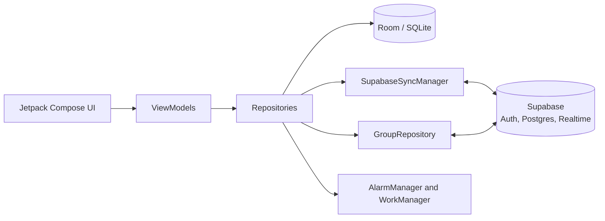

<div align="center">


# UniTask

**An offline-first Android task manager built for university life.**
Assignments, timetable, reminders, personal tasks and study groups in one app.
No ads, no tracking.

[](https://github.com/ahmad-maqsood/unitask/releases/latest)
[](https://github.com/ahmad-maqsood/unitask/releases)
[](https://www.android.com/)
[](https://kotlinlang.org/)
[](https://supabase.com/)
[](LICENSE)
[](https://hub.xerj.org/contributors/ahmad-maqsood)

[**⬇️ Download the latest APK**](https://github.com/ahmad-maqsood/unitask/releases/latest)

[Features](#features) · [Screenshots](#screenshots) · [Install](#install) · [What's new](#whats-new) · [Architecture](#architecture) · [Build your own](#build-your-own-copy) · [Privacy](#privacy-and-permissions) · [Support](#support)

</div>

---

## Overview

UniTask helps students keep track of what is due, when classes start and what the group still has to finish.

|   |   |
| --- | --- |
| 📴 **Works offline** | Deadlines, personal tasks, courses, the timetable and reminders all live on your phone. No account needed. |
| ☁️ **Optional cloud** | Sign in with Google to add cloud backup and shared study groups with chat. |
| 🔒 **Private by design** | No ads and no tracking. A personal project, built to solve everyday planning problems for me and my classmates. |

## Screenshots

<table align="center">
  <tr>
    <td align="center"></td>
    <td align="center"></td>
    <td align="center"></td>
  </tr>
  <tr>
    <td align="center"><sub><b>Deadlines</b><br/>Next class and stats</sub></td>
    <td align="center"><sub><b>Deadlines</b><br/>Task list</sub></td>
    <td align="center"><sub><b>Timetable</b><br/>Week A and Week B</sub></td>
  </tr>
  <tr>
    <td align="center"></td>
    <td align="center"></td>
    <td align="center"></td>
  </tr>
  <tr>
    <td align="center"><sub><b>Courses</b><br/>Modules and colour tags</sub></td>
    <td align="center"><sub><b>Settings</b><br/>Themes, sounds, backup</sub></td>
    <td align="center"><sub><b>Group chat</b><br/>Real-time study groups</sub></td>
  </tr>
</table>

<p align="center"><sub>Screenshots from v3.1.0.</sub></p>

## Install

1. Open the [latest release](https://github.com/ahmad-maqsood/unitask/releases/latest).
2. Download the `.apk` file and open it on your phone. Allow installation from your browser or file manager if Android asks.
3. Already installed? Tap the update button in the top bar, or open **Settings, Check for updates**. It compares your version with the newest GitHub release tag.

Requires **Android 7.0 (API 24)** or newer.

> [!NOTE]
> Beta builds are published as **pre-releases** on the [Releases page](https://github.com/ahmad-maqsood/unitask/releases). They are not offered by **Check for updates**, so install them by hand.

## Features

### 📚 Coursework

- **Deadlines:** assignments with priority, due date and exact time, linked to courses with colour coding.
  - A stats card shows Pending, Done and Due today.
  - Urgency grouping: Overdue, Due Today, Due Tomorrow, Upcoming, Completed.
  - **Swipe a card right** to mark it done, with Undo.
  - Calendar view with a month grid and deadline dots.
  - Checklist editor for subtasks, with live progress on the card.
  - Batch select to complete or delete many at once.
  - Multiple reminders per task, and offline file attachments up to 25 MB.
- **Courses:** modules, credit hours, instructors and colour tags that timetable slots and assignments inherit.
- **Repeating tasks:** repeat daily, on weekdays, weekly, every 2 weeks, monthly or yearly. Completing a repeating task moves it to its next due date.
- **My tasks:** a separate to-do list for things that are not coursework. Quick add, swipe to complete or delete with undo, and sections for overdue, today, tomorrow, later and done.

### 🗓️ Timetable

- Weekly and bi-weekly (**Week A** and **Week B**) schedules. Tell UniTask which week it is and the reminders, daily summary and next-class card follow it.
- Live "current and next class" card, free-time pills between classes (`☕ 1h 30m free`) and clash warnings.
- One-tap `.ics` export to Google Calendar, Outlook or Apple Calendar.

### 👥 Study groups

- Create or join a group with a **QR code** (scan it with the camera or from an image), an invite link or an 8-character code.
- Owner tools to rename the group, regenerate codes and transfer ownership.
- Shared tasks with member tagging (`@all`), shared courses and personal done ticks.
- **Group chat:** real-time search by keyword or sender, sticky date headers, earlier messages loaded in batches, swipe to reply with a quote, and an offline outbox that sends when you are back online.

### 🔔 Reminders and widget

- Alerts with **Mark as Done** and **Snooze 30m** buttons right in the notification.
- Optional alarm-style ringing for high-priority tasks, class reminders and a daily morning summary.
- Notifications are grouped by type so they do not flood the shade.
- **"UniTask Today" home-screen widget** shows today's classes and tasks. Tap a row to open the app.

### 🎨 Personalisation

- Light, dark or system theme, and six accent colours: Indigo, Ocean teal, Forest green, Rose, Sunset orange and Violet.
- Themed icon on Android 13 and newer.
- Notification sounds: Phone default, four built-in sounds, or any ringtone from your phone. Each sound has its own notification channel, so Android remembers the volume you set.

### 💾 Backup and data

- Automatic Google cloud sync with multi-account isolation.
- Password-protected offline backups and a JSON export of your data.
- Full account and cloud data deletion.
- GitHub release updater, an announcements bell and a built-in "Learn to use the app" guide.

## What's new

### 3.1.0

- **New app icon.** A U whose right arm stretches into a tick, with a gold dot. It also replaces the old graduation cap in notifications.
- **Swipe to mark done on Deadlines.** Swipe a card right to mark it done or not done, with Undo. It works for group tasks too (it only marks your own tick). Swiping left does nothing, so nothing is deleted by accident.
- **"Due today" on the stats card.** It replaces "Enrolled Courses", which rarely changed.
- **Clearer reminder buttons.** One **Snooze 30m** button instead of three snooze options, so the notification buttons are easier to read.
- **Tidier sound list.** Phone default is first, and the built-in sounds are named Sound 1 to Sound 4.

See the full history in the [CHANGELOG](CHANGELOG.md).

<details>
<summary><b>Earlier changes</b></summary>

- **A proper checklist editor.** Checklist items are rows with a checkbox, a text box and a remove button. Older checklists open as rows and keep working in task cards, backups and cloud sync.
- **Week A and Week B really work.** Choose the current week in Settings ("This week is") or from the Timetable tab. Class reminders, the daily summary and the next-class card only count classes that meet this week, and a Week A and a Week B class at the same time are no longer a clash.
- **Join a group with the camera.** Tap **Scan with camera**, or use **From image** or **Paste Link**. Scanning only fills the form, it never joins by itself.
- **Better notifications.** Group chat notifications read like a conversation. The daily summary mentions overdue tasks on days without classes. High-priority alarm notifications stay in the shade until you dismiss them. There is a switch for alarm-style ringing in Settings.
- **Groups stay put** when you lock and unlock the phone.
- **Faster, calmer sync messages.** Status messages replace each other and disappear sooner. The group refresh only runs while the app is open on a usable connection.
- **No double chat messages** when you send as the chat opens or the connection comes back.
- **Undo keeps attachments.** Undoing a deleted task brings back its files too.
- **Batch mode:** **Done** always marks tasks as done, **Delete** asks you to confirm, and the selection survives rotating the phone.
- **Real files when sharing.** Timetable export shares a `.ics` calendar file, and **Export my data** shares a `.json` file.
- **Update check:** beta users are offered the final release of the same version.
- **Smaller fixes:** Back inside a group goes to Tasks first, back on the home screen asks you to press it twice to exit, the time picker follows your 12 or 24 hour setting, classes that end after midnight are handled, and local backups keep the completion time of repeating tasks.
- **Deleting your account** also cancels reminders and removes attachments and cached group data from the phone.

</details>

## Architecture

UniTask is local-first. The screens read from a Room database, so the app stays fast and usable offline. Changes are pushed to Supabase in the background, and group data is read live.



### Tech stack

| Layer | Technology |
| --- | --- |
| UI | Kotlin, Jetpack Compose, Material 3 |
| Home-screen widget | Jetpack Glance |
| Local data | Room 2.8.5 with explicit migrations |
| Cloud | Supabase (`supabase-kt` 3.8.0): Auth with Google sign-in, PostgREST, Realtime |
| Networking | Ktor 3.6.1 |
| Background work | `AlarmManager` for exact reminders, `WorkManager` for periodic sync, message checks and announcement polling |
| Build | Android Gradle Plugin 9.5.0, Gradle 9.8.2 (Kotlin DSL), version catalog, KSP, min SDK 24, target SDK 36 |
| CI | GitHub Actions builds the signed release APK, runs tests and lint, and scans the code with CodeQL |

### How sync works

- Personal data is stored in Room first and pushed when signed in. Deletions are tracked so removed items do not come back, and a delete that fails (for example while offline) is kept and retried on the next sync.
- Group screens use Supabase Realtime for instant updates, with a short polling safety net in case an event is missed.
- Actions in groups (adding a task, ticking it done, sending a message) appear on screen immediately and are confirmed by the server a moment later.
- Row Level Security on every table decides who can read and write what. The anon key in the app is public by design and carries no extra access.
- Database triggers set the sender name and reply quote of chat messages, and the author name of group tasks, on the server, so a member cannot post under someone else's name.

<details>
<summary><b>Project layout</b></summary>

```text
app/src/main/java/com/example/
  data/
    local/         Room entities, DAOs, migrations, repeat rules
    groups/        Group repository and models (Supabase realtime)
    repository/    AppRepository for personal data
  sync/            SupabaseSyncManager, SyncWorker, PeriodicSyncWorker, SyncScheduler
  reminder/        Task, class, daily-summary, group and announcement alarms, snooze and receivers
  widget/          "UniTask Today" home-screen widget (Glance)
  ui/
    screens/       Compose screens, dialogs and ViewModels
    theme/         Colours, accent themes, typography, theme preference
  util/            Supabase client, local backup, update checker, announcements,
                   attachments, notification sounds, .ics export, QR codes
supabase/          schema.sql, a reference copy of the live database
.github/workflows/ Release APK build, tests, CodeQL and a Supabase keep-alive ping
```

</details>

## Build your own copy

Want to run UniTask with your own database, or change the code? Follow the step-by-step **[Setup guide](SETUP_GUIDE.md)**. It is written for beginners and covers:

- Creating a free [Supabase](https://supabase.com/) project and building the database with ready-to-paste SQL
- Setting up Google sign-in
- Creating a signing key
- Building the APK on GitHub (nothing to install) or in Android Studio
- Fixes for the most common problems

Just want to use the app? Download it from [Releases](https://github.com/ahmad-maqsood/unitask/releases/latest). No setup needed.

**Quick facts for developers**

- The values you change live in `app/build.gradle.kts`: `applicationId`, `SUPABASE_URL`, `SUPABASE_ANON_KEY` (your publishable key) and `GOOGLE_WEB_CLIENT_ID`.
- [`supabase/schema.sql`](supabase/schema.sql) documents the live database for reference. It is not a runnable script. The runnable SQL is in the [Setup guide](SETUP_GUIDE.md).
- Keep the same signing key for every release, otherwise users cannot update over their existing install.

## Reliable notifications

Some phone makers stop background apps aggressively. If reminders arrive late or not at all:

1. Allow **Autostart** for UniTask, if your phone has the option.
2. Set battery usage to **No restrictions**.
3. Allow background activity and exact alarms if Android asks.
4. Make sure notifications are enabled for UniTask.

> [!TIP]
> The in-app **Background setup** guide in Settings walks through these steps. Menu names differ between brands.

## Privacy and permissions

- Personal tasks, courses and the timetable live on your device and work without an account.
- Signing in is optional and only needed for cloud backup and groups.
- Local backups can be password-protected (encrypted). Only restore backups you trust.
- "Report a problem" opens a form with only the app version, Android version and phone model filled in.

| Permission | Why |
| --- | --- |
| `POST_NOTIFICATIONS` | Deadline, class, daily summary, chat and announcement alerts |
| `SCHEDULE_EXACT_ALARM` | Reminders at the exact time |
| `RECEIVE_BOOT_COMPLETED` | Restore reminders after a restart |
| `REQUEST_IGNORE_BATTERY_OPTIMIZATIONS` | Offer the battery setting for reliable reminders |
| `VIBRATE` | Alarm-style alerts |
| `CAMERA` | Optional. Scan a group's QR code. The app works without it |
| `INTERNET` | Cloud backup, groups, update checks and announcements |
| `ACCESS_NETWORK_STATE` | Check that you are online before syncing |

## Known limitations

- Chat notifications come from a background check, so Android battery limits can delay them. There is no external push service.
- Group chat is text only. Messages cannot be edited after sending, and messages older than 30 days are deleted automatically by a scheduled database job.
- Reminders depend on notification permissions and your phone's battery settings (see **Reliable notifications** above).
- The home-screen widget is read-only. Tapping a row opens the app, and you cannot tick a task off from the widget.
- A monthly repeating task set on the 29th, 30th or 31st moves to an earlier day after a short month.

## Support

- **Report a problem:** in the app, open **Settings, Report a problem**, or use the [form](https://docs.google.com/forms/d/e/1FAIpQLSdJpx67ioTDiYOvbntGTh-5AGFb213DFMJNitEl12MYYZSYNw/viewform). No GitHub account needed.
- **Request a feature:** **Settings, Request a feature** in the app.
- **Bugs and ideas:** [open an issue](https://github.com/ahmad-maqsood/unitask/issues/new/choose).
- **Security problems:** please do not use a public issue. See [SECURITY.md](SECURITY.md).

UniTask is a personal project, so I am not accepting pull requests. Bug reports and feedback are very welcome. See [CONTRIBUTING.md](CONTRIBUTING.md).

## License

Released under the [MIT License](LICENSE).

---

<div align="center">
<sub>Made with ☕ by <a href="https://github.com/ahmad-maqsood">Ahmad Maqsood</a> for students who have too many deadlines.</sub>
</div>
