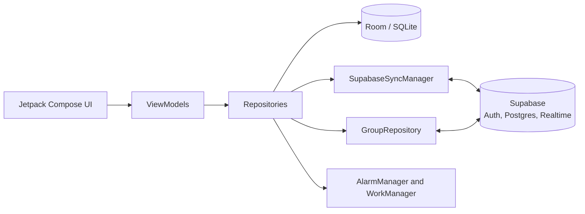

# UniTask
<div align="center">
 
**An offline-first Android task manager built for university life.**
Assignments, timetable, reminders, personal tasks and study groups in one app.
 
[](https://github.com/ahmad-maqsood/unitask/releases/latest)
[](https://github.com/ahmad-maqsood/unitask/releases)
[](https://www.android.com/)
[](https://kotlinlang.org/)
[](https://supabase.com/)
[](LICENSE)
 
[Download](#download) · [Features](#features) · [Architecture](#architecture) · [Build from source](#build-from-source) · [Report a problem](#support)
 
</div>
 
## Overview
 
UniTask helps students keep track of what is due, when classes start and what the group still has to finish. Everything personal works without an account and without internet. Signing in with Google adds cloud backup and shared study groups.
 
It is a personal project with no ads and no tracking, built to solve everyday planning problems for me and my classmates.
 
## Screenshots

<p align="center">
  
  
  
</p>
<p align="center">
  
  
</p>
<p align="center"><sub>Deadlines · My tasks · Timetable · Courses · Group chat · Settings</sub></p>
 
## Download
 
1. Open the [latest release](https://github.com/ahmad-maqsood/unitask/releases/latest).
2. Download `unitask.apk` and open it on your phone. Allow installation from your browser or file manager if Android asks.
3. Already installed? Open **Settings, Check for updates** inside the app. It compares your version with the newest GitHub release tag.
Requires Android 7.0 (API 24) or newer.
 
## Features
 
| Area | What you get |
| --- | --- |
| **Deadlines** | Assignments with priority, due date and exact time, linked to courses with colour coding. Multiple reminders per task. Done tasks sink to the bottom. Filter by status, course or source (personal or group), search, and sort. Offline file attachments up to 25 MB. |
| **My tasks** | A separate to-do list for things that are not coursework. Quick add, swipe to complete or delete with undo, and sections for overdue, today, tomorrow, later and done. |
| **Repeating tasks** | Repeat daily, on weekdays, weekly, every 2 weeks, monthly or yearly. Completing a repeating task moves it to its next date. |
| **Timetable** | Weekly class schedule with rooms and instructors, a live "current and next class" card, class-start alerts and a 10-minute early reminder. |
| **Courses** | Course details, progress, instructors and pending workload at a glance. |
| **Study groups** | Create or join a group with a unique handle and join code. Shared tasks with member tagging (or `@all`), shared courses, personal done-ticks, group chat with unread badges, and owner/admin roles. Duplicate course codes are blocked inside a group. |
| **Reminders** | Alerts at the deadline, 1 hour, 2 hours, 12 hours, 1 day or 2 days before. High-priority tasks can ring like an alarm. Custom notification sounds and an optional daily summary. Reminders are restored after a reboot. |
| **Backup** | Cloud backup through Supabase when signed in. Local backup files you can protect with a password, which also restore older backups. |
| **In-app updates** | Update check against GitHub Releases, plus a feature guide and announcements that can be changed from the backend without releasing a new version. |
 
<details>
<summary><b>What's new in 2.0.0</b></summary>
<br>
- **Moved to Supabase** for sign-in, cloud backup, group sync and realtime updates (replacing Firebase and Firestore).
- **My tasks and repeating tasks**, with a new bottom navigation bar.
- **12-hours-before reminder** and alarm-style alerts for high-priority tasks.
- **Faster, steadier groups:** realtime connections no longer block refreshes, group lists are cached for an instant start, and false "task deleted" notices were fixed.
- **Pull to refresh** now waits for the sync and reports the result.
- **Feature guide and announcements** loaded from Supabase.
- Local backups now include My tasks and repeat rules and still restore old backup files.
Full list: [v1.3.0 ... main](https://github.com/ahmad-maqsood/unitask/compare/v1.3.0...main)
 
</details>
## Architecture
 
UniTask is local-first. The screens read from a Room database, so the app stays fast and usable offline. Changes are pushed to Supabase in the background, and group data is read live.
 

 
| Layer | Technology |
| --- | --- |
| UI | Kotlin, Jetpack Compose, Material 3, Coil |
| Local data | Room 2.7 with explicit migrations |
| Cloud | Supabase (`supabase-kt` 3.2): Auth with Google sign-in, PostgREST, Realtime |
| Networking | Ktor |
| Background work | `AlarmManager` for exact reminders, `WorkManager` for periodic sync and message checks |
| Build | Gradle (Kotlin DSL), version catalog, KSP, min SDK 24, target SDK 36 |
 
**Sync notes**
 
- Personal data is stored in Room first and pushed when signed in. Deletions are tracked so removed items do not come back.
- Group screens use Supabase Realtime for instant updates, with a short polling safety net in case an event is missed.
- Actions in groups (adding a task, ticking it done, sending a message) appear on screen immediately and are confirmed by the server a moment later.
- Row Level Security on every table decides who can read and write what. The anon key in the app is public by design and carries no extra access.
<details>
<summary><b>Project layout</b></summary>
```text
app/src/main/java/com/example/
  data/
    local/         Room entities, DAOs, migrations, repeat rules
    groups/        Group repository and models (Supabase realtime)
    repository/    AppRepository for personal data
  sync/            SupabaseSyncManager, SyncWorker, GroupSyncWorker, scheduler
  reminder/        Task, class, daily-summary and group alarms and receivers
  ui/
    screens/       Compose screens, dialogs and ViewModels
    theme/         Colours, typography, theme preference
  util/            Supabase client, local backup, update checker, announcements
```
 
</details>
## Build from source
 
**Prerequisites:** a recent Android Studio, JDK 17 or newer, and a free [Supabase](https://supabase.com/) project.
 
```bash
git clone https://github.com/ahmad-maqsood/unitask.git
cd unitask
```
 
**1. Backend (Supabase)**
 
- Enable the Google provider under Authentication.
- Create the tables the app uses: `courses`, `tasks`, `slots`, `groups`, `group_members`, `group_tasks`, `group_courses`, `group_done`, `group_messages`, `app_features` and `announcements`, plus the `create_group` and `join_group` functions. Turn on Row Level Security for every table and add policies that limit each user to their own rows or groups.
- Enable Realtime for the group tables.
**2. App configuration**
 
Set these values in `app/build.gradle.kts`, inside `defaultConfig`:
 
| Field | Value |
| --- | --- |
| `SUPABASE_URL` | Your project URL |
| `SUPABASE_ANON_KEY` | Your project's anon (public) key |
| `GOOGLE_WEB_CLIENT_ID` | The Web client ID from Google Cloud Console |
 
Register your build's signing certificate (SHA-1) on an Android OAuth client in Google Cloud Console, or Google sign-in will fail.
 
**3. Signing and build**
 
Release builds read the keystore from `my-upload-key.jks` in the project root (or `KEYSTORE_PATH`) and the `STORE_PASSWORD` and `KEY_PASSWORD` environment variables. Keep keystores out of Git; `*.jks` is already ignored.
 
```bash
./gradlew assembleDebug      # debug build
./gradlew assembleRelease    # signed release build
```
 
Keep the same signing key for every release, otherwise users cannot update over their existing install.
 
## Reliable notifications
 
Some phone makers stop background apps aggressively. If reminders arrive late or not at all:
 
1. Allow **Autostart** for UniTask, if your phone has the option.
2. Set battery usage to **No restrictions**.
3. Allow background activity and exact alarms if Android asks.
4. Make sure notifications are enabled for UniTask.
The in-app **Background setup** guide in Settings walks through these steps. Menu names differ between brands.
 
## Privacy and permissions
 
- Personal tasks, courses and the timetable live on your device and work without an account.
- Signing in is optional and only needed for cloud backup and groups.
- Local backups can be password-protected (encrypted). Only restore backups you trust.
- "Report a problem" opens a form with only the app version, Android version and phone model filled in.
| Permission | Why |
| --- | --- |
| `POST_NOTIFICATIONS` | Deadline, class, daily summary and chat alerts |
| `SCHEDULE_EXACT_ALARM` | Reminders at the exact time |
| `RECEIVE_BOOT_COMPLETED` | Restore reminders after a restart |
| `REQUEST_IGNORE_BATTERY_OPTIMIZATIONS` | Offer the battery setting for reliable reminders |
| `VIBRATE` | Alarm-style alerts |
| `INTERNET` | Cloud backup, groups and update checks |
 
## Known limitations
 
- Chat notifications come from a background check, so Android battery limits can delay them. There is no push service.
- Group chat is text only, messages cannot be edited, and only the newest 100 are shown.
- Reminders depend on notification permission and the phone's alarm and background settings.
- Cloud features need internet. Personal tasks and the timetable work offline.
- A monthly repeating task set on the 29th, 30th or 31st moves to an earlier day after a short month.
## Support
 
- **Report a problem:** in the app, open **Settings, Report a problem**, or use the [form](https://docs.google.com/forms/d/e/1FAIpQLSdJpx67ioTDiYOvbntGTh-5AGFb213DFMJNitEl12MYYZSYNw/viewform). No GitHub account needed.
- **Request a feature:** **Settings, Request a feature** in the app.
- **Bugs and ideas:** [open an issue](https://github.com/ahmad-maqsood/unitask/issues).
## License
 
Released under the [MIT License](LICENSE).
