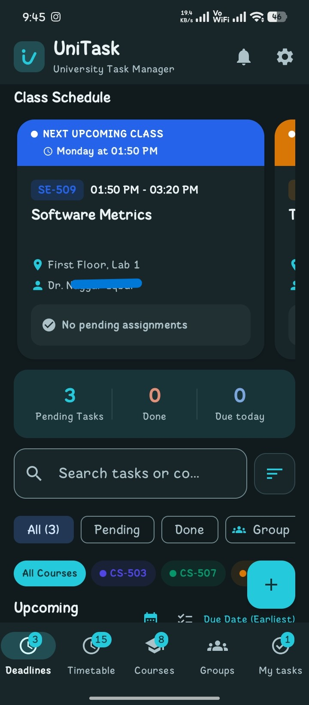
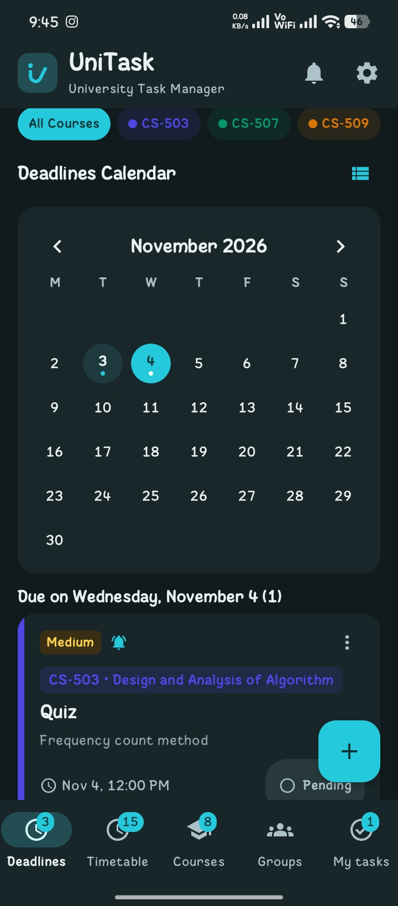
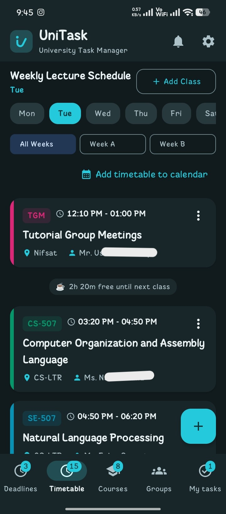
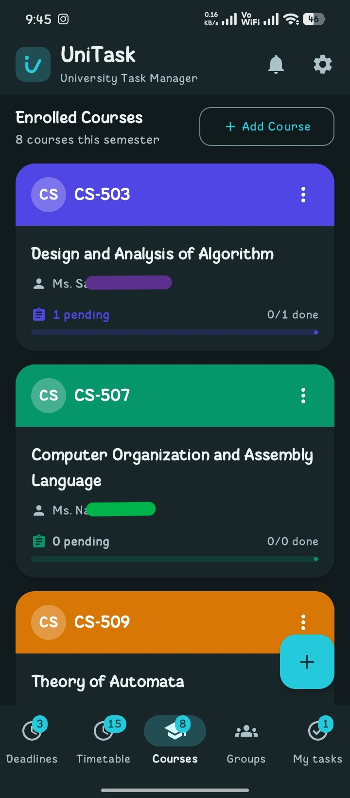
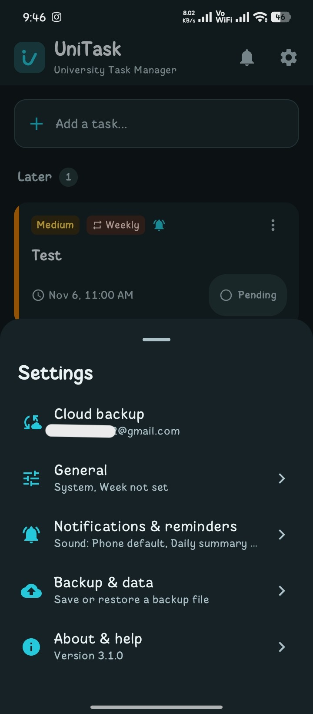
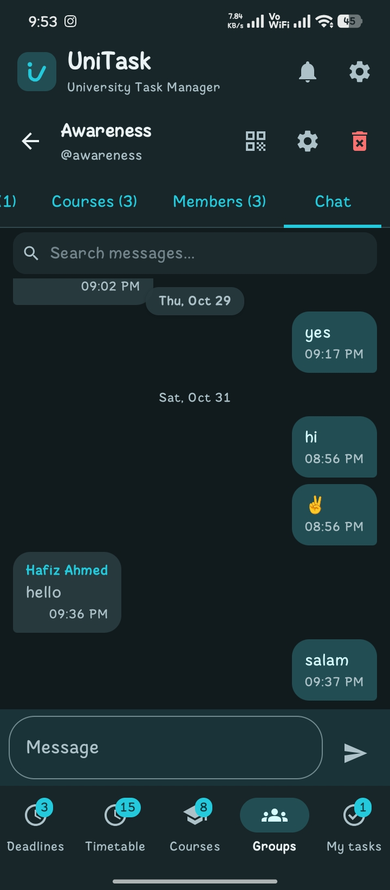
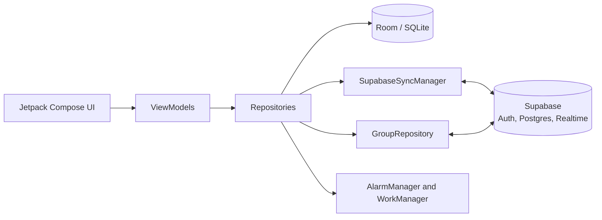

<div align="center">


# UniTask

**A local-first Android task manager for university students.**

Deadlines, timetable, reminders, personal tasks and study groups in a single application.
No advertising. No tracking.

[](https://github.com/ahmad-maqsood/unitask/releases/latest)
[](https://github.com/ahmad-maqsood/unitask/releases)
[](https://www.android.com/)
[](https://kotlinlang.org/)
[](https://supabase.com/)
[](LICENSE)
[](https://hub.xerj.org/contributors/ahmad-maqsood)

[**Download the latest APK**](https://github.com/ahmad-maqsood/unitask/releases/latest)

[Overview](#overview) · [Screenshots](#screenshots) · [Installation](#installation) · [Features](#features) · [What's new](#whats-new) · [Architecture](#architecture) · [Building from source](#building-from-source) · [Privacy](#privacy-and-permissions) · [Support](#support)

</div>

---

## Overview

UniTask helps students keep track of what is due, when classes start and what their study group still has to finish. It is designed around three principles.

| Principle | Description |
| --- | --- |
| **Offline first** | Deadlines, personal tasks, courses, the timetable and reminders are stored on the device. No account is required to use them. |
| **Optional cloud** | Signing in with Google adds cloud backup and shared study groups with chat. |
| **Private by design** | The application contains no advertising and no tracking. |

UniTask is a personal project, created to solve everyday planning problems for its author and classmates.

## Screenshots

<table align="center">
  <tr>
    <td align="center"></td>
    <td align="center"></td>
    <td align="center"></td>
  </tr>
  <tr>
    <td align="center"><sub><b>Deadlines</b><br/>Next class and statistics</sub></td>
    <td align="center"><sub><b>Deadlines</b><br/>Task list</sub></td>
    <td align="center"><sub><b>Timetable</b><br/>Week A and Week B</sub></td>
  </tr>
  <tr>
    <td align="center"></td>
    <td align="center"></td>
    <td align="center"></td>
  </tr>
  <tr>
    <td align="center"><sub><b>Courses</b><br/>Modules and colour tags</sub></td>
    <td align="center"><sub><b>Settings</b><br/>Themes, sounds and backup</sub></td>
    <td align="center"><sub><b>Group chat</b><br/>Real-time study groups</sub></td>
  </tr>
</table>

<p align="center"><sub>Screenshots are from version 3.1.0.</sub></p>

## Installation

1. Open the [latest release](https://github.com/ahmad-maqsood/unitask/releases/latest).
2. Download the `.apk` file and open it on your phone. If Android asks, allow installation from your browser or file manager.
3. To update an existing installation, use the update button in the top bar or open **Settings, Check for updates**. The check compares your installed version with the tag of the newest GitHub release.

UniTask requires **Android 7.0 (API 24)** or newer.

> [!NOTE]
> Beta builds are published as **pre-releases** on the [Releases page](https://github.com/ahmad-maqsood/unitask/releases). They are not offered by **Check for updates** and must be installed manually.

## Features

### Coursework

- **Deadlines.** Assignments with priority, due date and exact time, linked to colour-coded courses.
  - A statistics card shows Pending, Done and Due today.
  - Tasks are grouped by urgency: Overdue, Due Today, Due Tomorrow, Upcoming and Completed.
  - Swipe a card to the right to mark it done, with Undo.
  - A calendar view shows a month grid with deadline indicators.
  - A checklist editor supports subtasks, with live progress on the card.
  - Batch selection completes or deletes several tasks at once.
  - Each task can have multiple reminders and offline file attachments of up to 25 MB.
- **Courses.** Modules, credit hours, instructors and colour tags, which timetable slots and assignments inherit.
- **Repeating tasks.** Tasks can repeat daily, on weekdays, weekly, every two weeks, monthly or yearly. A completed repeating task moves to its next due date and its checklist is reset.
- **My tasks.** A separate to-do list for items that are not coursework, with quick add, swipe to complete or delete with undo, and sections for overdue, today, tomorrow, later and done. One-time tasks can use **Delete when done**, which removes them the day after they are finished.

### Timetable

- Weekly and bi-weekly (**Week A** and **Week B**) schedules. Once you set the current week, reminders, the daily summary and the next-class card follow it.
- A live current and next class card, free-time indicators between classes and clash warnings.
- One-tap `.ics` export for Google Calendar, Outlook and Apple Calendar.

### Study groups

- Create or join a group with a **QR code** (scanned with the camera or from an image), an invite link or an 8-character code.
- Owner tools to rename the group, regenerate codes and transfer ownership.
- Shared tasks with member tagging (`@all`), shared courses and personal done ticks.
- **Group chat** with real-time search by keyword or sender, sticky date headers, earlier messages loaded in batches, swipe to reply with a quote, and an offline outbox that sends messages when the connection returns.

### Reminders and widget

- Notifications include **Mark as Done** and **Snooze 30m** actions.
- Snooze from the task card for 30 minutes, 1 hour, 3 hours or tomorrow morning. The card shows "Snoozed until ...".
- On Android 13 and newer, reminders ring at the exact time. Reminders are skipped for tasks that were already finished or deleted.
- A **Missed reminder** notification reports reminders that were due while the phone was off.
- **Check reminders** in Settings tests notifications, exact alarms and battery settings, can fix detected problems and can send a test reminder.
- Optional alarm-style ringing for high-priority tasks, class reminders and a daily morning summary.
- Notifications are grouped by type to keep the notification shade readable.
- The **UniTask Today** home-screen widget shows today's classes and tasks. Tapping a row opens the app.

### Personalisation

- Light, dark or system theme, and six accent colours: Indigo, Ocean teal, Forest green, Rose, Sunset orange and Violet.
- Themed icon on Android 13 and newer.
- Notification sounds: the phone default, four built-in sounds or any ringtone on the phone. Each sound has its own notification channel, so Android remembers the volume you set.

### Backup and data

- Automatic Google cloud sync with multi-account isolation.
- Password-protected offline backups and a JSON export of your data.
- Complete account and cloud data deletion.
- A GitHub release updater, an announcements bell and a built-in **Learn to use the app** guide.

## What's new

### 3.2.0

- **Task checklists and calendar actions.** Edit checklist items from the task dialog, follow progress on cards and swipe calendar tasks to complete or undo them.
- **Flexible snoozing.** Snooze from a task card or notification for 30 minutes, 1 hour, 3 hours or tomorrow at 8:00 AM.
- **Smarter repeating tasks.** Monthly and yearly tasks keep their original day across shorter months and leap years. Missed repeats roll forward and reset their checklists.
- **Update alerts.** An in-app prompt and a notification bell card announce new stable releases.
- **Reminder diagnostics and recovery.** Check notification, exact-alarm and battery settings, fix detected issues, send a test reminder and receive a notice about reminders missed while the phone was off.
- **Delete when done.** Optionally remove completed one-time My tasks after their completion day.
- **Reliability.** Improved synchronisation, account-switch cleanup, reminder recovery and notification handling.

The complete history is available in the [CHANGELOG](CHANGELOG.md).

<details>
<summary><b>Earlier changes</b></summary>

- **Today home-screen widget.** Shows today's classes, upcoming tasks and the number of overdue tasks.
- **Notification history.** View past notifications with unread counts and quick navigation. Daily summaries are readable from the history.
- **Six accent colour themes.**
- **Checklist editor.** Each item is a row with a checkbox, a text box and a remove button. Older checklists open as rows and continue to work in task cards, backups and cloud sync.
- **Week A and Week B.** Choose the current week in Settings (**This week is**) or from the Timetable tab. Class reminders, the daily summary and the next-class card count only the classes that meet this week, and a Week A class and a Week B class at the same time no longer count as a clash.
- **Joining a group with the camera.** Use **Scan with camera**, **From image** or **Paste Link**. Scanning only fills in the form and never joins automatically.
- **Improved notifications.** Group chat notifications read like a conversation, the daily summary mentions overdue tasks on days without classes, high-priority alarm notifications remain until dismissed, and Settings has a switch for alarm-style ringing.
- **Stable group screens** when the phone is locked and unlocked.
- **Calmer sync messages.** Status messages replace each other and disappear sooner. The group refresh runs only while the app is open on a usable connection.
- **No duplicate chat messages** when a message is sent as the chat opens or the connection returns.
- **Undo keeps attachments.** Undoing a task deletion also restores its files.
- **Batch mode.** **Done** always marks tasks as done, **Delete** asks for confirmation and the selection survives screen rotation.
- **Real files when sharing.** Timetable export shares an `.ics` file and **Export my data** shares a `.json` file.
- **Update check.** Beta users are offered the final release of the same version.
- **Smaller fixes.** Back inside a group returns to Tasks first, pressing Back twice on the home screen exits, the time picker follows the 12 or 24 hour setting, classes that end after midnight are handled and local backups keep the completion time of repeating tasks.
- **Account deletion** also cancels reminders and removes attachments and cached group data from the phone.

</details>

## Architecture

UniTask is local-first. The screens read from a Room database, so the application remains fast and usable offline. Changes are pushed to Supabase in the background, and group data is read live.



### Technology stack

| Layer | Technology |
| --- | --- |
| UI | Kotlin, Jetpack Compose, Material 3 |
| Home-screen widget | Jetpack Glance |
| Local data | Room 2.8.5 with explicit migrations |
| Cloud | Supabase (`supabase-kt` 3.8.0): Auth with Google sign-in, PostgREST and Realtime |
| Networking | Ktor 3.6.1 |
| Background work | `AlarmManager` for exact reminders, `WorkManager` for periodic sync, message checks and announcement polling |
| Build | Android Gradle Plugin 9.5.0, Gradle 9.8.2 (Kotlin DSL), version catalog, KSP, minimum SDK 24, target SDK 36 |
| Continuous integration | GitHub Actions builds the signed release APK, runs tests and lint, and scans the code with CodeQL |

### Synchronisation

- Personal data is written to Room first and pushed to the cloud when the user is signed in. Deletions are tracked so removed items do not return. A delete that fails, for example while offline, is kept and retried on the next sync.
- Group screens use Supabase Realtime for instant updates, with a short polling safety net in case an event is missed.
- Actions in groups, such as adding a task, ticking it done or sending a message, appear on screen immediately and are confirmed by the server shortly afterwards.
- Row Level Security on every table controls who can read and write which data. The anon key in the application is public by design and carries no additional access.
- Database triggers set the sender name and reply quote of chat messages, and the author name of group tasks, on the server. A member therefore cannot post under another member's name.

<details>
<summary><b>Project layout</b></summary>

```text
app/src/main/java/com/example/
  data/
    local/         Room entities, DAOs, migrations, repeat rules
    groups/        Group repository and models (Supabase realtime)
    repository/    AppRepository for personal data
  sync/            SupabaseSyncManager, SyncWorker, PeriodicSyncWorker, SyncScheduler
  reminder/        Task, class, daily-summary, group and announcement alarms, snooze and receivers
  widget/          "UniTask Today" home-screen widget (Glance)
  ui/
    screens/       Compose screens, dialogs and ViewModels
    theme/         Colours, accent themes, typography, theme preference
  util/            Supabase client, local backup, update checker, announcements,
                   attachments, notification sounds, .ics export, QR codes
app/schemas/       Room database schema files, one per version, read by the migration test
supabase/          schema.sql, a reference copy of the live database
.github/workflows/ Release APK build, tests, CodeQL and a Supabase keep-alive ping
```

</details>

## Building from source

To run UniTask against your own database or to modify the code, follow the step-by-step **[Setup guide](SETUP_GUIDE.md)**. It is written for beginners and covers:

- Creating a free [Supabase](https://supabase.com/) project and building the database with ready-to-paste SQL
- Configuring Google sign-in
- Creating a signing key
- Building the APK on GitHub (no local installation required) or in Android Studio
- Solutions to the most common problems

If you only want to use the application, download it from [Releases](https://github.com/ahmad-maqsood/unitask/releases/latest). No setup is required.

**Notes for developers**

- The values to change are in `app/build.gradle.kts`: `applicationId`, `SUPABASE_URL`, `SUPABASE_ANON_KEY` (your publishable key) and `GOOGLE_WEB_CLIENT_ID`.
- [`supabase/schema.sql`](supabase/schema.sql) documents the live database for reference. It is not a runnable script. The runnable SQL is in the [Setup guide](SETUP_GUIDE.md).
- Use the same signing key for every release. Otherwise users cannot update over their existing installation.

## Reliable notifications

Some phone manufacturers aggressively stop background applications. If reminders arrive late or not at all:

1. Allow **Autostart** for UniTask, if your phone offers the option.
2. Set battery usage to **No restrictions**.
3. Allow background activity and exact alarms if Android asks.
4. Confirm that notifications are enabled for UniTask.
5. Open **Settings, Check reminders**. It shows what is wrong, fixes it with one tap and can send a test reminder.

> [!TIP]
> The in-app **Background setup** guide in Settings walks through these steps. Menu names differ between manufacturers.

## Privacy and permissions

- Personal tasks, courses and the timetable are stored on the device and work without an account.
- Signing in is optional and is needed only for cloud backup and groups.
- Local backups can be password-protected (encrypted). Restore only backups you trust.
- **Report a problem** opens a form that is pre-filled with only the app version, Android version and phone model.

| Permission | Purpose |
| --- | --- |
| `POST_NOTIFICATIONS` | Deadline, class, daily summary, chat and announcement alerts |
| `USE_EXACT_ALARM` | Reminders at the exact time on Android 13 and newer. Granted automatically |
| `SCHEDULE_EXACT_ALARM` | The same on Android 12 only. It may need to be allowed in Settings |
| `RECEIVE_BOOT_COMPLETED` | Restores reminders after a restart |
| `REQUEST_IGNORE_BATTERY_OPTIMIZATIONS` | Offers the battery setting for reliable reminders |
| `VIBRATE` | Alarm-style alerts |
| `CAMERA` | Optional. Scans a group's QR code. The application works without it |
| `INTERNET` | Cloud backup, groups, update checks and announcements |
| `ACCESS_NETWORK_STATE` | Checks that the device is online before syncing |

## Known limitations

- Chat notifications come from a background check, so Android battery limits can delay them. No external push service is used.
- Group chat supports text only. Messages cannot be edited after sending, and messages older than 30 days are deleted automatically by a scheduled database job.
- Reminders depend on notification permissions and the phone's battery settings (see [Reliable notifications](#reliable-notifications)).
- Snoozes and the **Delete when done** setting belong to the phone on which they were set. They are not synchronised to the cloud, although **Delete when done** is kept in local backups.
- The home-screen widget is read-only. Tapping a row opens the application, but tasks cannot be completed from the widget.

## Support

- **Report a problem:** in the app, open **Settings, Report a problem**, or use the [form](https://docs.google.com/forms/d/e/1FAIpQLSdJpx67ioTDiYOvbntGTh-5AGFb213DFMJNitEl12MYYZSYNw/viewform). No GitHub account is needed.
- **Request a feature:** use **Settings, Request a feature** in the app.
- **Bugs and ideas:** [open an issue](https://github.com/ahmad-maqsood/unitask/issues/new/choose).
- **Security issues:** please do not use a public issue. See [SECURITY.md](SECURITY.md).

UniTask is a personal project, but community contributions and pull requests are welcome. See [CONTRIBUTING.md](CONTRIBUTING.md) for guidelines.

## License

Released under the [MIT License](LICENSE).
