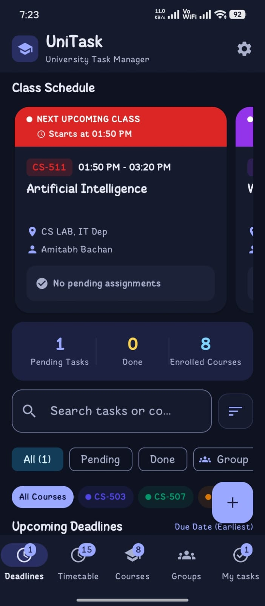
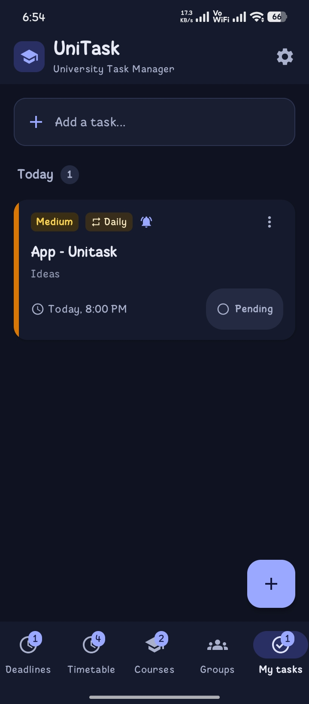
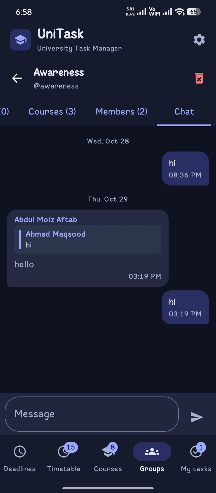
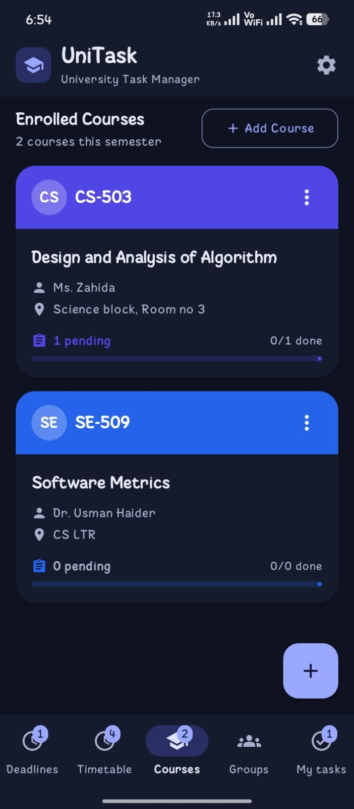
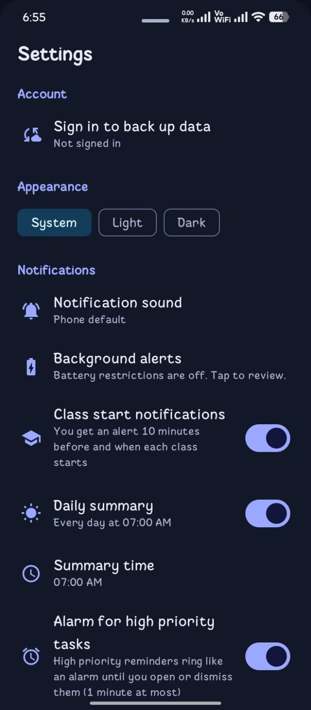
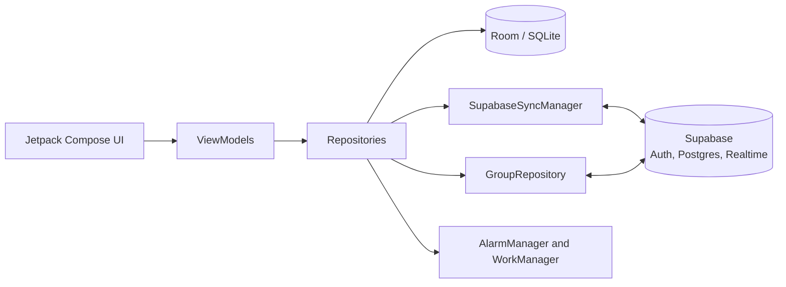

# UniTask
<div align="center">
 
**An offline-first Android task manager built for university life.**
Assignments, timetable, reminders, personal tasks and study groups in one app.
 
[](https://github.com/ahmad-maqsood/unitask/releases/latest)
[](https://github.com/ahmad-maqsood/unitask/releases)
[](https://www.android.com/)
[](https://kotlinlang.org/)
[](https://supabase.com/)
[](LICENSE)
 
[Download](#download) · [Features](#features) · [Architecture](#architecture) · [Build from source](#build-from-source) · [Report a problem](#support)
 
</div>
 
## Overview
 
UniTask helps students keep track of what is due, when classes start and what the group still has to finish. Everything personal works without an account and without internet. Signing in with Google adds cloud backup and shared study groups.
 
It is a personal project with no ads and no tracking, built to solve everyday planning problems for me and my classmates.
 
## Screenshots

<p align="center">
  
  
  
</p>
<p align="center">
  
  
</p>
<p align="center"><sub>Deadlines · My tasks · Group chat · Courses · Settings</sub></p>
 
## Download
 
1. Open the [latest release](https://github.com/ahmad-maqsood/unitask/releases/latest).
2. Download the `.apk` file and open it on your phone. Allow installation from your browser or file manager if Android asks.
3. Already installed? Open **Settings, Check for updates** inside the app. It compares your version with the newest GitHub release tag.
Requires Android 7.0 (API 24) or newer.
 
## Features
 
| Area | What you get |
| --- | --- |
| **Deadlines** | Assignments with priority, due date and exact time, linked to courses with colour coding. Calendar view with month grid and deadline dots. Interactive subtasks and checklists (`- [ ]`). Batch multi-select mode for bulk completion and deletion. Urgency grouping (Overdue, Today, Tomorrow, Upcoming, Completed). Multiple reminders per task. Offline file attachments up to 25 MB. |
| **My tasks** | A separate to-do list for non-coursework tasks. Quick add, swipe to complete or delete with undo, and sections for overdue, today, tomorrow, later, and done. |
| **Repeating tasks** | Repeat daily, on weekdays, weekly, every 2 weeks, monthly, or yearly. Completing a repeating task automatically moves it to its next due date. |
| **Timetable** | Weekly and bi-weekly (Week A & B) class schedules. Live "current and next class" indicator, automatic free time / break pills (`☕ 1h 30m free`), clash/conflict warnings, and one-tap `.ics` export to Google Calendar or Outlook. |
| **Courses** | Course modules, credit hours, instructors, and custom colour tags inherited by timetable slots and assignments. |
| **Study groups** | Create or join groups via QR code generation/scanning, universal links, or 8-character codes. Owner tools to edit name/handle, regenerate codes, and transfer ownership. Shared tasks with member tagging (`@all`), shared courses, and personal done ticks. |
| **Group chat** | In-chat real-time search by keyword or sender, floating sticky date headers while scrolling, infinite scroll pagination to load earlier messages, swipe-to-reply, and a persistent offline outbox queue. |
| **Reminders** | Alerts with interactive "Mark as Done" action buttons on lock screen and notification tray. High-priority alarm-style ringing, custom notification ringtones, and daily morning summaries. |
| **Backup & Privacy** | Automatic Google Cloud sync with multi-account isolation. GDPR-compliant JSON Data Export and complete Account & Cloud Data purge. Password-encrypted offline backups. |
| **In-app updates** | GitHub release updater, official university announcements bell, and a built-in interactive "Learn to use the app" feature guide. |

<details open>
<summary><b>What's new in 3.0.0 (Latest Release, currently in beta testing)</b></summary>

- **Interactive Calendar View for Deadlines:** Toggle between standard list and a monthly calendar grid showing deadline dot indicators and day-specific assignment filtering.
- **Subtasks & Checklists:** Add `- [ ]` checklist items to tasks with a dedicated "+ Add Checklist Item" button and live subtask progress chips on task cards.
- **Batch Operations:** Multi-select mode with checkboxes to bulk complete or delete assignments in one tap.
- **Bi-Weekly Timetable Support (Week A & B):** Schedule classes that alternate weekly and filter your timetable view between All, Week A, and Week B.
- **Class Break & Free Time Indicators:** Visual pills highlight free gaps between consecutive lectures (e.g. `☕ 1h 30m free until next class`).
- **Export Timetable to System Calendar (.ics):** Export your lecture schedule to Google Calendar, Outlook, or Apple Calendar with weekly recurring rules.
- **Timetable Conflict Detection:** Automatic alerts before saving overlapping classes to prevent double booking.
- **Group QR Codes & Invite Links:** Display high-contrast QR codes, share universal invite links, scan QR screenshots, or paste invite links from clipboard.
- **Group Ownership Transfer & Owner Tools:** Hand over group ownership to another member, edit group name/handle, and regenerate 8-character join codes.
- **In-Chat Message Search & Sticky Date Headers:** Filter group chat in real-time and track dates with floating headers while scrolling.
- **Chat Pagination & Offline Outbox:** Scroll back through earlier messages in batches of 50, and send messages offline with automatic background queue flushing.
- **Notification "Mark as Done" Action:** Complete tasks directly from reminder notifications without opening the app.
- **GDPR Data Export & Account Deletion:** Export all personal data as JSON and permanently purge cloud/local data with one tap.
- **Multi-Account Cache Isolation:** Prevents data blending when switching Google accounts, with zero data loss on logout.

All releases: [GitHub Releases](https://github.com/ahmad-maqsood/unitask/releases)

</details>

<details>
<summary><b>What's new in 2.3.0-beta</b></summary>

- **Light, dark and system theme.** Pick your preferred appearance in Settings. The choice is saved on the device.
- **Multiple notification sounds.** Choose from four built-in sounds, your phone's default, or any ringtone installed on your phone. Each sound has its own notification channel so Android remembers the volume you set.
- **Announcement notifications.** New announcements are shown as phone notifications even when the app is closed, checked roughly every 15 minutes in the background. At most three are posted at once to avoid flooding your shade.
- **High-priority alarm toggle.** Turn the alarm-style ringing on or off directly in Settings without digging through Android notification settings.

All releases: [GitHub Releases](https://github.com/ahmad-maqsood/unitask/releases)

</details>

<details>
<summary><b>What's new in 2.1.1</b></summary>

- **Group chat no longer shows repeated messages** when a new message arrives. A message you send now keeps one identity from the moment you tap send until the server confirms it.
- **Correct message and task times on Android 8 to 12.** Server timestamps are now read in a way every Android version accepts.
- **Deletes that fail are retried.** Deleting a task, course or class while offline no longer leaves a hidden copy in the cloud.
- **Names in group chat and group tasks are verified by the server**, so nobody can post under another member's name.
- **Reply to a message** by swiping it right in group chat, with a quote that jumps back to the original.
- **Completed repeating tasks roll over to their next date** automatically every day.
- **Group tasks are cached** for offline viewing, and groups stay visible while sign-in is still loading.
- **Join codes are 8 characters** (new groups only; existing codes keep working).

</details>

<details>
<summary><b>What's new in 2.0.0</b></summary>
<br>
- **Moved to Supabase** for sign-in, cloud backup, group sync and realtime updates (replacing Firebase and Firestore).
- **My tasks and repeating tasks**, with a new bottom navigation bar.
- **12-hours-before reminder** and alarm-style alerts for high-priority tasks.
- **Faster, steadier groups:** realtime connections no longer block refreshes, group lists are cached for an instant start, and false "task deleted" notices were fixed.
- **Pull to refresh** now waits for the sync and reports the result.
- **Feature guide and announcements** loaded from Supabase.
- Local backups now include My tasks and repeat rules and still restore old backup files.
Full list: [v1.3.0 ... main](https://github.com/ahmad-maqsood/unitask/compare/v1.3.0...main)
 
</details>

## Architecture
 
UniTask is local-first. The screens read from a Room database, so the app stays fast and usable offline. Changes are pushed to Supabase in the background, and group data is read live.
 

 
| Layer | Technology |
| --- | --- |
| UI | Kotlin, Jetpack Compose, Material 3 |
| Local data | Room 2.7 with explicit migrations |
| Cloud | Supabase (`supabase-kt` 3.2.4): Auth with Google sign-in, PostgREST, Realtime |
| Networking | Ktor 3.2.3 |
| Background work | `AlarmManager` for exact reminders, `WorkManager` for periodic sync, message checks and announcement polling |
| Build | Gradle 9.1.1 (Kotlin DSL), version catalog, KSP, min SDK 24, target SDK 36 |
 
**Sync notes**
 
- Personal data is stored in Room first and pushed when signed in. Deletions are tracked so removed items do not come back, and a delete that fails (for example while offline) is kept and retried on the next sync.
- Group screens use Supabase Realtime for instant updates, with a short polling safety net in case an event is missed.
- Actions in groups (adding a task, ticking it done, sending a message) appear on screen immediately and are confirmed by the server a moment later.
- Row Level Security on every table decides who can read and write what. The anon key in the app is public by design and carries no extra access.
- Database triggers set the sender name and reply quote of chat messages, and the author name of group tasks, on the server, so a member cannot post under someone else's name.
<details>
<summary><b>Project layout</b></summary>

```text
app/src/main/java/com/example/
  data/
    local/         Room entities, DAOs, migrations, repeat rules
    groups/        Group repository and models (Supabase realtime)
    repository/    AppRepository for personal data
  sync/            SupabaseSyncManager, SyncWorker, GroupSyncWorker, AnnouncementWorker, scheduler
  reminder/        Task, class, daily-summary, group and announcement alarms and receivers
  ui/
    screens/       Compose screens, dialogs and ViewModels
    theme/         Colours, typography, theme preference
  util/            Supabase client, local backup, update checker, announcements, attachment manager
```
 
</details>

## Build from source
 
**Prerequisites:** a recent Android Studio, JDK 17 or newer, and a free [Supabase](https://supabase.com/) project.
 
```bash
git clone https://github.com/ahmad-maqsood/unitask.git
cd unitask
```
 
**1. Backend (Supabase)**
 
- Enable the Google provider under Authentication.
- Create the tables the app uses: `courses`, `tasks`, `slots`, `groups`, `group_members`, `group_tasks`, `group_courses`, `group_done`, `group_messages`, `app_features` and `announcements`, plus the `create_group` and `join_group` functions. Turn on Row Level Security for every table and add policies that limit each user to their own rows or groups.
- Enable Realtime for the group tables.
- [`supabase/schema.sql`](supabase/schema.sql) documents the live setup: tables, Row Level Security policies, functions, triggers, indexes and the 30-day chat cleanup job. Use it as a reference to recreate the backend. It is documentation, so read it before running anything from it.

**2. App configuration**
 
Set these values in `app/build.gradle.kts`, inside `defaultConfig`:
 
| Field | Value |
| --- | --- |
| `SUPABASE_URL` | Your project URL |
| `SUPABASE_ANON_KEY` | Your project's anon (public) key |
| `GOOGLE_WEB_CLIENT_ID` | The Web client ID from Google Cloud Console |
 
Register your build's signing certificate (SHA-1) on an Android OAuth client in Google Cloud Console, or Google sign-in will fail.
 
**3. Signing and build**
 
Release builds read the keystore from `my-upload-key.jks` in the project root (or `KEYSTORE_PATH`) and the `STORE_PASSWORD` and `KEY_PASSWORD` environment variables. Keep keystores out of Git; `*.jks` is already ignored.
 
```bash
./gradlew assembleDebug      # debug build
./gradlew assembleRelease    # signed release build
```
 
Keep the same signing key for every release, otherwise users cannot update over their existing install.
 
## Reliable notifications
 
Some phone makers stop background apps aggressively. If reminders arrive late or not at all:
 
1. Allow **Autostart** for UniTask, if your phone has the option.
2. Set battery usage to **No restrictions**.
3. Allow background activity and exact alarms if Android asks.
4. Make sure notifications are enabled for UniTask.
The in-app **Background setup** guide in Settings walks through these steps. Menu names differ between brands.
 
## Privacy and permissions
 
- Personal tasks, courses and the timetable live on your device and work without an account.
- Signing in is optional and only needed for cloud backup and groups.
- Local backups can be password-protected (encrypted). Only restore backups you trust.
- "Report a problem" opens a form with only the app version, Android version and phone model filled in.

| Permission | Why |
| --- | --- |
| `POST_NOTIFICATIONS` | Deadline, class, daily summary, chat and announcement alerts |
| `SCHEDULE_EXACT_ALARM` | Reminders at the exact time |
| `RECEIVE_BOOT_COMPLETED` | Restore reminders after a restart |
| `REQUEST_IGNORE_BATTERY_OPTIMIZATIONS` | Offer the battery setting for reliable reminders |
| `VIBRATE` | Alarm-style alerts |
| `INTERNET` | Cloud backup, groups, update checks and announcements |
 
## Known limitations
 
- Chat notifications come from a background check, so Android battery limits can delay them. There is no external push service.
- Group chat is text only; messages cannot be edited after sending, and messages older than 30 days are purged automatically by database cron.
- Reminders depend on notification permissions and your phone's battery optimization settings (see Background setup guide in Settings).
- Cloud features require internet, while all personal tasks, timetable slots, and courses work 100% offline.
- A monthly repeating task set on the 29th, 30th, or 31st moves to an earlier day after a short month.

## Support
 
- **Report a problem:** in the app, open **Settings, Report a problem**, or use the [form](https://docs.google.com/forms/d/e/1FAIpQLSdJpx67ioTDiYOvbntGTh-5AGFb213DFMJNitEl12MYYZSYNw/viewform). No GitHub account needed.
- **Request a feature:** **Settings, Request a feature** in the app.
- **Bugs and ideas:** [open an issue](https://github.com/ahmad-maqsood/unitask/issues).

## License
 
Released under the [MIT License](LICENSE).
