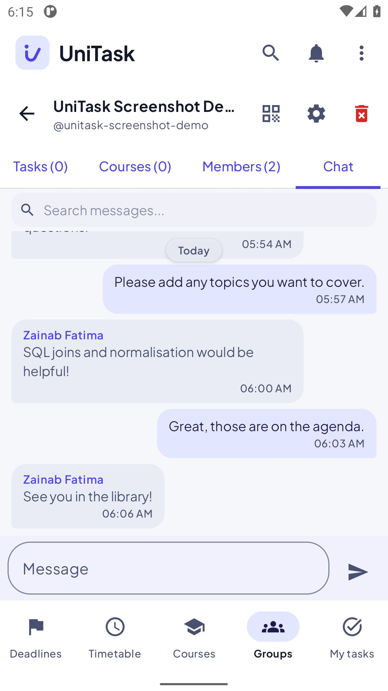
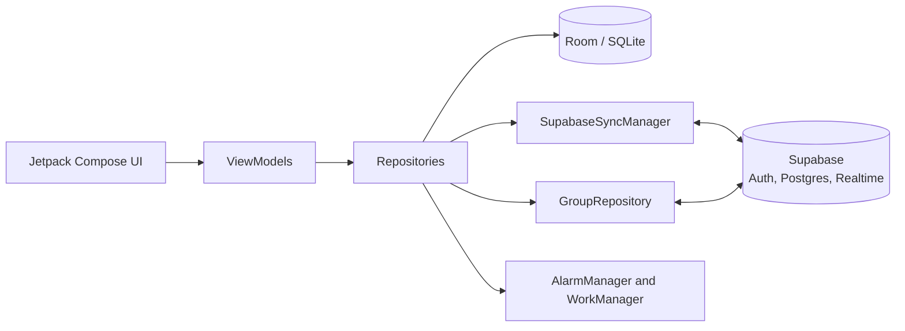

<div align="center">


# UniTask

**A local-first Android task manager for university students.**

Deadlines, timetable, reminders, personal tasks and study groups in a single application.
No advertising. No tracking.

[](https://github.com/ahmad-maqsood/unitask/releases/latest)
[](https://github.com/ahmad-maqsood/unitask/releases)
[](https://www.android.com/)
[](https://kotlinlang.org/)
[](https://supabase.com/)
[](LICENSE)
[](https://hub.xerj.org/contributors/ahmad-maqsood)

[**Download the latest APK**](https://github.com/ahmad-maqsood/unitask/releases/latest)

[Overview](#overview) · [Screenshots](#screenshots) · [Installation](#installation) · [Building from source](#building-from-source) · [Features](#features) · [Architecture](#architecture) · [Privacy](#privacy-and-permissions) · [Support](#support)

</div>

---

## Overview

UniTask helps students keep track of what is due, when classes start and what their study group still has to finish. It is designed around three principles.

| Principle | Description |
| --- | --- |
| **Offline first** | Deadlines, personal tasks, courses, the timetable and reminders are stored on the device. No account is required to use them. |
| **Optional cloud** | Signing in with Google adds cloud backup and shared study groups with chat. |
| **Private by design** | The application contains no advertising and no tracking. |

UniTask is a personal project, created to solve everyday planning problems for its author and classmates.

## Screenshots

<table align="center">
  <tr>
    <td align="center"><a href="docs/screenshots/deadlines.jpg"></a><br/><sub><b>Deadlines</b><br/>Upcoming work and daily overview</sub></td>
    <td align="center"><a href="docs/screenshots/timetable.jpg"></a><br/><sub><b>Timetable</b><br/>Weekly class schedule</sub></td>
    <td align="center"><a href="docs/screenshots/courses.jpg"></a><br/><sub><b>Courses</b><br/>Course list and colour coding</sub></td>
  </tr>
  <tr>
    <td align="center"><a href="docs/screenshots/groups.jpg"></a><br/><sub><b>Study groups</b><br/>Shared study spaces</sub></td>
    <td align="center"><a href="docs/screenshots/group_chat.jpg"></a><br/><sub><b>Group chat</b><br/>A real conversation with fictional demo messages</sub></td>
    <td align="center"><a href="docs/screenshots/my_tasks.jpg"></a><br/><sub><b>My tasks</b><br/>Personal to-do list</sub></td>
  </tr>
  <tr>
    <td align="center"><a href="docs/screenshots/notes.jpg"></a><br/><sub><b>Notes</b><br/>Pinned and course-linked notes</sub></td>
    <td align="center"><a href="docs/screenshots/note_preview.jpg"></a><br/><sub><b>Note preview</b><br/>Formatted Markdown preview</sub></td>
    <td align="center"><a href="docs/screenshots/note_editor.jpg"></a><br/><sub><b>Note editor</b><br/>Markdown editing and formatting tools</sub></td>
  </tr>
  <tr>
    <td align="center"><a href="docs/screenshots/settings_menu.jpg"></a><br/><sub><b>Settings</b><br/>Settings overview</sub></td>
    <td align="center"><a href="docs/screenshots/settings_general.jpg"></a><br/><sub><b>General settings</b><br/>Theme and app preferences</sub></td>
    <td align="center"><a href="docs/screenshots/settings_notifications.jpg"></a><br/><sub><b>Notifications</b><br/>Reminder controls</sub></td>
  </tr>
</table>

<table align="center">
  <tr>
    <td align="center"><a href="docs/screenshots/settings_backup.jpg"></a><br/><sub><b>Backup and data</b><br/>Backup and data options</sub></td>
    <td align="center"><a href="docs/screenshots/settings_about.jpg"></a><br/><sub><b>About and help</b><br/>App information and support</sub></td>
  </tr>
</table>

<p align="center"><sub>Automatically captured from UniTask 3.5.0 using fictional demo data on an Android emulator.</sub></p>

Each screen is also available separately: [**Deadlines**](docs/screenshots/deadlines.jpg) · [**Timetable**](docs/screenshots/timetable.jpg) · [**Courses**](docs/screenshots/courses.jpg) · [**Study groups**](docs/screenshots/groups.jpg) · [**Group chat**](docs/screenshots/group_chat.jpg) · [**My tasks**](docs/screenshots/my_tasks.jpg) · [**Notes**](docs/screenshots/notes.jpg) · [**Note preview**](docs/screenshots/note_preview.jpg) · [**Note editor**](docs/screenshots/note_editor.jpg) · [**Settings**](docs/screenshots/settings_menu.jpg) · [**General settings**](docs/screenshots/settings_general.jpg) · [**Notifications**](docs/screenshots/settings_notifications.jpg) · [**Backup and data**](docs/screenshots/settings_backup.jpg) · [**About and help**](docs/screenshots/settings_about.jpg).
## Installation

1. Open the [latest release](https://github.com/ahmad-maqsood/unitask/releases/latest).
2. Download the `.apk` file and open it on your phone. If Android asks, allow installation from your browser or file manager.
3. To update an existing installation, use the update button in the top bar or open **Settings, Check for updates**. The check compares your installed version with the tag of the newest GitHub release.

UniTask requires **Android 7.0 (API 24)** or newer.

> [!NOTE]
> Beta builds are published as **pre-releases** on the [Releases page](https://github.com/ahmad-maqsood/unitask/releases). They are not offered by **Check for updates** and must be installed manually.

## Building from Source

To build UniTask, install Android Studio with a JDK compatible with the project's Gradle configuration, then clone this repository and open it in Android Studio:

```bash
git clone https://github.com/ahmad-maqsood/unitask.git
```

Let Gradle sync before building. Cloud features that use Supabase or Google Sign-In require your own service configuration and credentials. Never commit secrets to the repository.

## Features

### Coursework

- **Deadlines.** Assignments with priority, due date and exact time, linked to colour-coded courses.
  - A statistics card shows Pending, Done and Due today.
  - Tasks are grouped by urgency: Overdue, Due Today, Due Tomorrow, Upcoming and Completed.
  - Swipe a card to the right to mark it done, with Undo.
  - A calendar view shows a month grid with deadline indicators.
  - A checklist editor supports subtasks, with live progress on the card.
  - Batch selection completes or deletes several tasks at once.
  - Each task can have multiple reminders and offline file attachments of up to 25 MB.
- **Courses.** Modules, credit hours, instructors and colour tags, which timetable slots and assignments inherit.
- **Repeating tasks.** Tasks can repeat daily, on weekdays, weekly, every two weeks, monthly or yearly. A completed repeating task moves to its next due date and its checklist is reset.
- **My tasks.** A separate to-do list for items that are not coursework, with quick add, swipe to complete or delete with undo, and sections for overdue, today, tomorrow, later and done. One-time tasks can use **Delete when done**, which removes them the day after they are finished.

### Notes

- **Markdown notes.** Notes with an optional course tag, opened from the Tools menu in the top bar.
  - Formatting toolbar with shortcuts for headings, bold, italic, strikethrough, checklists, bulleted and numbered lists, quotes, inline code, code blocks, links, tables and images.
  - Edit and Preview modes with interactive checklists that can be ticked in Preview.
  - Fast search by title and content, filter by course, pin important notes and sort by updated date, created date or title.
  - Autosave as you type with full undo and redo history in the editor.
  - Recently deleted notes are kept in the trash for 30 days before permanent deletion, with instant restore.
  - Share notes as plain text or export as `.md` files, and import `.md` or `.txt` files directly into Notes.
  - Open Markdown files from other apps via "Open with" and Share, and save the preview to Notes.
  - Photos from the gallery are stored locally with thumbnail preview, full-screen viewing and automatic orphan cleanup.
  - Notes are included in encrypted local backups, data export and cloud sync with conflict protection.
  - Deleting a course keeps notes safe and cleanly detaches the course link.

### Study timer

- **Stopwatch and countdown.** Track study sessions with a stopwatch or a 15, 25, 45 or 60-minute countdown, or set a custom duration. Pause and resume whenever needed, use a fullscreen landscape display, and keep the screen awake. A notification alerts you when a countdown ends, even if UniTask is closed. The timer can keep running when you leave its screen, with an active indicator on the Tools button.

### Timetable

- Weekly and bi-weekly (**Week A** and **Week B**) schedules. Once you set the current week, reminders, the daily summary and the next-class card follow it.
- A live current and next class card, free-time indicators between classes and clash warnings.
- One-tap `.ics` export for Google Calendar, Outlook and Apple Calendar.

### Study groups

- Create or join a group with a **QR code** (scanned with the camera or from an image), an invite link or an 8-character code.
- Owner tools to rename the group, regenerate codes and transfer ownership.
- Shared tasks with member tagging (`@all`), shared courses and personal done ticks.
- **Group chat** with real-time search by keyword or sender, sticky date headers, earlier messages loaded in batches, swipe to reply with a quote, and an offline outbox that sends messages when the connection returns.

### Reminders and widget

- Notifications include **Mark as Done** and **Snooze 30m** actions.
- Snooze from the task card for 30 minutes, 1 hour, 3 hours or tomorrow morning. The card shows "Snoozed until ...".
- On Android 13 and newer, reminders ring at the exact time. Reminders are skipped for tasks that were already finished or deleted.
- A **Missed reminder** notification reports reminders that were due while the phone was off.
- **Check reminders** in Settings tests notifications, exact alarms and battery settings, can fix detected problems and can send a test reminder.
- Optional alarm-style ringing for high-priority tasks, class reminders and a daily morning summary.
- Notifications are grouped by type to keep the notification shade readable.
- **Notification history.** Review past alerts, see unread counts and jump back to the relevant item; daily summaries remain available in the history.
- The **UniTask Today** home-screen widget shows today's classes and tasks. Tapping a row opens the app.

### Personalisation

- Light, dark or system theme, and six accent colours: Indigo, Ocean teal, Forest green, Rose, Sunset orange and Violet.
- Themed icon on Android 13 and newer.
- Notification sounds: the phone default, four built-in sounds or any ringtone on the phone. Each sound has its own notification channel, so Android remembers the volume you set.

### Google Drive backup

- **Private cloud backup.** Saves one hidden backup in the user's own Google Drive that only UniTask can see. It cannot see your other files.
  - Includes courses, timetable, assignments with attachments, My tasks, notes with pictures and app settings.
  - Back up on a tap or daily after the app opens (runs at most once a day and only when something has changed).
  - Restore on a new phone with settings applied at once.
  - Two rotating copies ensure a failed upload cannot destroy the last good one.
  - Wi-Fi only and attachments switches to control mobile data and storage.

### Backup and data

- Automatic Google cloud sync with multi-account isolation.
- Password-protected offline backups and a JSON export of your data.
- Complete account and cloud data deletion.
- A GitHub release updater, an announcements bell and a built-in **Learn to use the app** guide.

## Architecture

UniTask is local-first. The screens read from a Room database, so the application remains fast and usable offline. Changes are pushed to Supabase in the background, and group data is read live.



### Technology stack

| Layer | Technology |
| --- | --- |
| UI | Kotlin, Jetpack Compose, Material 3 |
| Home-screen widget | Jetpack Glance |
| Local data | Room 2.8.5 with explicit migrations |
| Cloud | Supabase (`supabase-kt` 3.8.0): Auth with Google sign-in, PostgREST and Realtime |
| Networking | Ktor 3.6.1 |
| Background work | `AlarmManager` for exact reminders, `WorkManager` for periodic sync, message checks and announcement polling |
| Build | Android Gradle Plugin 9.5.0, Gradle 9.8.2 (Kotlin DSL), version catalog, KSP, minimum SDK 24, target SDK 36 |
| Continuous integration | GitHub Actions builds the signed release APK, runs tests and lint, and scans the code with CodeQL |

### Synchronisation

- Personal data is written to Room first and pushed to the cloud when the user is signed in. Deletions are tracked so removed items do not return. A delete that fails, for example while offline, is kept and retried on the next sync.
- Group screens use Supabase Realtime for instant updates, with a short polling safety net in case an event is missed.
- Actions in groups, such as adding a task, ticking it done or sending a message, appear on screen immediately and are confirmed by the server shortly afterwards.
- Row Level Security on every table controls who can read and write which data. The anon key in the application is public by design and carries no additional access.
- Database triggers set the sender name and reply quote of chat messages, and the author name of group tasks, on the server. A member therefore cannot post under another member's name.

<details>
<summary><b>Project layout</b></summary>

```text
app/src/main/java/com/example/
  data/
    local/         Room entities, DAOs, migrations, repeat rules
    groups/        Group repository and models (Supabase realtime)
    repository/    AppRepository for personal data, NoteRepository
  sync/            SupabaseSyncManager, NoteSync, SyncWorker, PeriodicSyncWorker, SyncScheduler
  reminder/        Task, class, daily-summary, group and announcement alarms, snooze and receivers
  widget/          "UniTask Today" home-screen widget (Glance)
  ui/
    screens/       Compose screens, dialogs and ViewModels
    theme/         Colours, accent themes, typography, theme preference
  util/            Supabase client, local backup, update checker, announcements,
                   attachments, notification sounds, .ics export, QR codes
app/schemas/       Room database schema files, one per version, read by the migration test
supabase/          schema.sql, a reference copy of the live database
.github/workflows/ Release APK build, tests, CodeQL and a Supabase keep-alive ping
```

</details>

## Reliable notifications

Some phone manufacturers aggressively stop background applications. If reminders arrive late or not at all:

1. Allow **Autostart** for UniTask, if your phone offers the option.
2. Set battery usage to **No restrictions**.
3. Allow background activity and exact alarms if Android asks.
4. Confirm that notifications are enabled for UniTask.
5. Open **Settings, Check reminders**. It shows what is wrong, fixes it with one tap and can send a test reminder.

> [!TIP]
> The in-app **Background setup** guide in Settings walks through these steps. Menu names differ between manufacturers.

## Privacy and permissions

- Personal tasks, courses, the timetable and notes are stored on the device and work without an account.
- Signing in is optional and is needed only for cloud backup, notes sync and groups. Notes are stored on the device and are uploaded only when signed in.
- Google Drive backup: the only permission asked is access to the app's own hidden folder in Google Drive (the appdata scope). The app cannot see other Drive files, and the user can remove access in their Google account settings.
- Local backups can be password-protected (encrypted). Restore only backups you trust.
- **Report a problem** opens a form that is pre-filled with only the app version, Android version and phone model.

| Permission | Purpose |
| --- | --- |
| `POST_NOTIFICATIONS` | Deadline, class, daily summary, chat and announcement alerts |
| `USE_EXACT_ALARM` | Reminders at the exact time on Android 13 and newer. Granted automatically |
| `SCHEDULE_EXACT_ALARM` | The same on Android 12 only. It may need to be allowed in Settings |
| `RECEIVE_BOOT_COMPLETED` | Restores reminders after a restart |
| `REQUEST_IGNORE_BATTERY_OPTIMIZATIONS` | Offers the battery setting for reliable reminders |
| `VIBRATE` | Alarm-style alerts |
| `CAMERA` | Optional. Scans a group's QR code. The application works without it |
| `INTERNET` | Cloud backup, groups, update checks and announcements |
| `ACCESS_NETWORK_STATE` | Checks that the device is online before syncing |

## Known limitations

- The Drive backup is a snapshot, not live sync between phones.
- Only one backup (two rotating copies) is kept.
- Restoring merges data and does not remove anything, but app settings from the backup replace the ones on the phone.
- Note pictures larger than 20 MB and attachments larger than 25 MB are skipped.
- Android permissions (notifications, alarms, battery) are not part of a backup, the app asks for them again.
- A phone ringtone chosen as notification sound is restored as the system sound.
- The backup file made in Settings (Backup file) does not include attachments or settings.
- The Drive backup is not encrypted by UniTask and is stored in the user's own Google Drive.
- The daily backup needs the app to be opened.
- Chat notifications come from a background check, so Android battery limits can delay them. No external push service is used.
- Group chat supports text only. Messages cannot be edited after sending, and to keep the database small, each group keeps only its 500 newest messages (older ones are removed automatically as new ones arrive), and messages older than 30 days are deleted automatically by a scheduled database job.
- Reminders depend on notification permissions and the phone's battery settings (see [Reliable notifications](#reliable-notifications)).
- Snoozes and the **Delete when done** setting belong to the phone on which they were set. They are not synchronised to the cloud, although **Delete when done** is kept in local backups.
- The home-screen widget is read-only. Tapping a row opens the application, but tasks cannot be completed from the widget.
- Note images stay on the phone (they are in local backups but not in cloud sync).
- Notes are limited to 200,000 characters and 10 images.

## Support

- **Report a problem:** in the app, open **Settings, Report a problem**, or use the [form](https://docs.google.com/forms/d/e/1FAIpQLSdJpx67ioTDiYOvbntGTh-5AGFb213DFMJNitEl12MYYZSYNw/viewform). No GitHub account is needed.
- **Request a feature:** use **Settings, Request a feature** in the app.
- **Bugs and ideas:** [open an issue](https://github.com/ahmad-maqsood/unitask/issues/new/choose).
- **Security issues:** please do not use a public issue. See [SECURITY.md](SECURITY.md).

UniTask is a personal project, but community contributions and pull requests are welcome. See [CONTRIBUTING.md](CONTRIBUTING.md) for guidelines.

## License

Released under the [MIT License](LICENSE).
